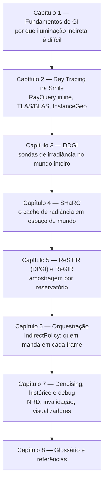
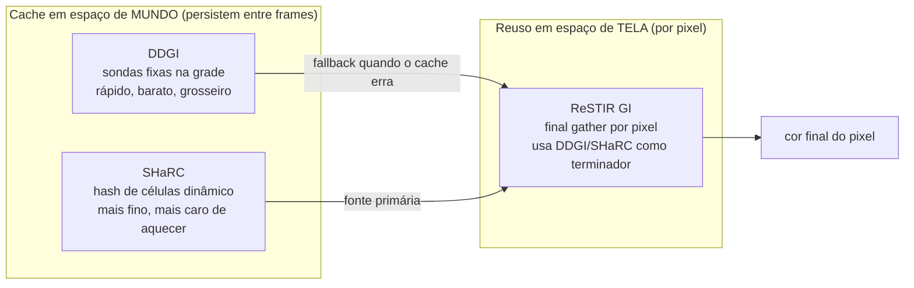

# Curso: Iluminação Global na SmileEngine

> Um curso para quem nunca mexeu com iluminação global (GI) explicar, na prática, como a
> SmileEngine ilumina uma cena inteira em tempo real — combinando **DDGI**, **SHaRC** (o
> radiance cache em espaço de mundo) e **ReSTIR** (DI e GI) num único pipeline coerente.
>
> Este não é um curso teórico genérico de "como funciona ray tracing". É um curso sobre **o
> código que existe neste repositório**, escrito para alguém que nunca abriu `Renderer.cpp`
> na vida. Cada capítulo cita arquivos e linhas reais — você pode (e deve) abrir o código ao
> lado enquanto lê.

## Para quem é este curso

Você não precisa saber DirectX 12, HLSL ou ray tracing de antemão. Você precisa saber:

- Programação em geral (variáveis, loops, structs) — C++ ajuda, mas não é obrigatório;
- Que uma tela é uma grade de pixels e que cada pixel tem uma cor final calculada por frame;
- Curiosidade para abrir um arquivo `.hlsl` e não entrar em pânico com a sintaxe (é parecida
  com C).

Cada capítulo introduz o vocabulário novo antes de usá-lo. Se um termo aparecer sem
explicação, ele está no **Glossário** (capítulo 8) — pode pular para lá a qualquer momento.

## Como o curso está organizado

O curso segue a ordem em que a luz realmente viaja dentro do motor: primeiro os fundamentos
(o que é GI e por que ela é cara), depois a infraestrutura que sustenta tudo (ray tracing
inline), depois cada algoritmo de GI isoladamente, e por fim como a engine decide, frame a
frame, qual algoritmo manda.

## Os capítulos

| # | Capítulo | O que você vai entender |
|---|----------|--------------------------|
| 1 | [Fundamentos de Iluminação Global](01-Fundamentos-Iluminacao-Global.md) | Luz direta × indireta, por que GI em tempo real é um problema em aberto, o "menu" de técnicas que a indústria usa |
| 2 | [Ray Tracing na Smile](02-Ray-Tracing-Na-Smile.md) | RayQuery inline (DXR 1.1), BLAS/TLAS, como um raio secundário nasce e o que ele "vê" |
| 3 | [DDGI — Sondas de Irradiância](03-DDGI-Probes-De-Irradiancia.md) | A grade de sondas, atlas octaédrico, Chebyshev, relocação, cascatas |
| 4 | [SHaRC — Radiance Cache em Espaço de Mundo](04-SHaRC-Radiance-Cache.md) | Hash grid, o "path tracer de dentro do path tracer", aquecimento, confiança |
| 5 | [ReSTIR, DI, GI e ReGIR](05-ReSTIR-DI-GI-ReGIR.md) | Reservoir sampling, reuso temporal/espacial, por que isso é mágica estatística legítima |
| 6 | [Orquestração — IndirectPolicy](06-Orquestracao-IndirectPolicy.md) | Como a engine decide, a cada frame, quem produz a luz indireta e quem cobre a falha |
| 7 | [Denoising, Histórico e Debug](07-Denoising-Temporal-Debug.md) | NRD, por que "invalidar histórico" é o contrato mais fácil de quebrar, as ferramentas de diagnóstico |
| 8 | [Glossário e Referências](08-Glossario-Referencias.md) | Todo termo técnico numa lista só, mais os papers que a engine implementa |

## O mapa mental que vale a pena guardar desde já

A GI da Smile não é "um algoritmo". É uma **cadeia de responsabilidade** entre três sistemas,
cada um bom em uma coisa e ruim em outra:

Guarde esta frase — ela é repetida (com mais detalhe) em quase todo capítulo, porque é a
chave para não se perder: **o SHaRC e o DDGI não competem entre si "para o pixel"; eles
respondem à mesma pergunta — "quanta luz chega aqui, vinda de qualquer direção, depois de
um ou mais quiques?" — em resoluções diferentes, e o ReSTIR GI é quem decide, raio a raio,
para qual dos dois perguntar.**

## Onde estamos, hoje, no código (25/08/2026)

Este curso descreve o sistema **como ele existe agora**, não um design ideal. Dois fatos
valem a pena saber antes de começar:

- O **SHaRC é a fonte primária de GI por padrão** desde a Fase 5 do plano de implementação
  (`Docs/SHARC-PRIMARY-GI-PLAN.md`), com o **DDGI como fallback** — quando o cache erra ou
  está "frio" (recém-criado), o DDGI responde no lugar. Na cena de referência (Bistro
  exterior), o SHaRC atende ~68% dos hits secundários e o DDGI cobre os outros ~30%.
- O **DDGI nunca desaparece por completo**: mesmo com SHaRC como primário, ele continua
  iluminando a névoa volumétrica, a folhagem, o subsurface scattering e os translúcidos —
  papéis que o SHaRC não cobre porque é "cego" de direção (ele guarda irradiância média, não
  um campo de luz).

Continue para o [Capítulo 1](01-Fundamentos-Iluminacao-Global.md).
