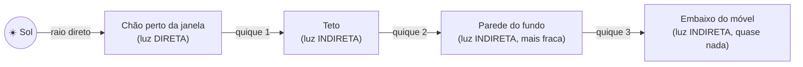
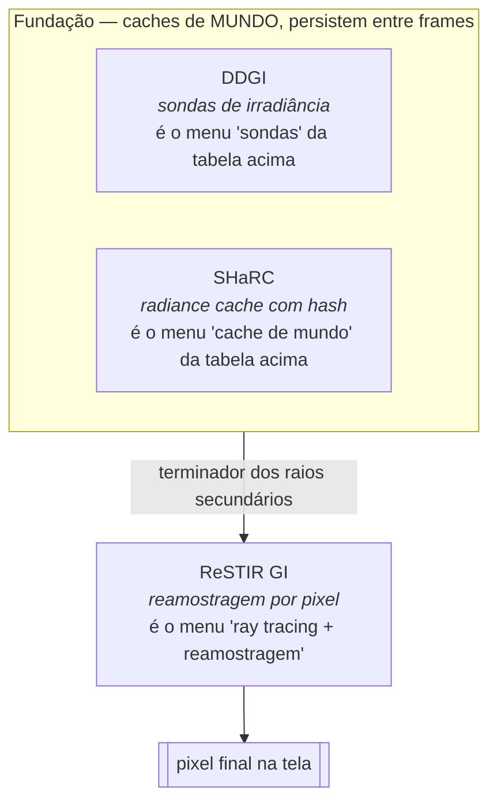

# Capítulo 1 — Fundamentos de Iluminação Global

> [Índice](00-Indice.md) · Próximo: [Capítulo 2 — Ray Tracing na Smile](02-Ray-Tracing-Na-Smile.md)

## 1.1 O problema, em uma imagem

Imagine um quarto branco, com uma janela e o sol lá fora. Se você desenhasse esse quarto
pensando só em "quais superfícies o sol bate diretamente", você teria: o chão perto da
janela iluminado, e o resto do quarto — teto, paredes de trás, embaixo dos móveis — **em
preto absoluto**. Isso é fisicamente errado e visualmente feio. Na vida real, o quarto
inteiro tem alguma luz, porque a luz que bate no chão **quica** e ilumina o teto, que quica
de novo e ilumina a parede, e assim por diante.

- **Luz direta**: sai da fonte de luz (sol, lâmpada) e bate direto numa superfície, sem
  quicar em nada no meio. É "fácil" de calcular: você sabe onde está a luz, sabe onde está a
  superfície, traça uma linha reta entre as duas e pergunta "tem algo no caminho fazendo
  sombra?".
- **Luz indireta** (= **Iluminação Global**, GI): é tudo que chega numa superfície depois de
  quicar em pelo menos **uma** outra superfície antes. Ela é o que faz um quarto branco
  parecer um quarto — e não uma caverna com um holofote.

**O problema prático:** cada quique pode, teoricamente, ir para qualquer direção, e cada
direção pode quicar de novo. É uma cadeia infinita (na prática, a energia cai rápido a cada
quique — depois de 3–4 quiques já sobra pouca luz — mas calcular mesmo só os primeiros 2–3
quiques de forma exata, para cada pixel da tela, 60 vezes por segundo, é uma quantidade de
trabalho absurda para qualquer GPU de hoje).

## 1.2 Por que não "simplesmente" traçar todos os raios?

A técnica fisicamente correta chama-se **path tracing**: de cada pixel, você atira um raio,
ele bate em algo, desse ponto você atira outro raio numa direção aleatória (ponderada pelo
material), ele bate em outra coisa, você repete por alguns quiques, e no fim soma toda a luz
recolhida no caminho. É assim que filmes de animação renderizam suas imagens — e leva
**minutos a horas por frame**, mesmo em fazendas de servidores.

Um jogo (ou o editor da Smile, que roda em tempo real no viewport) precisa de um frame a
cada **~16 milissegundos** (60 FPS) ou menos. Path tracing "puro" com qualidade de filme
está muitas ordens de magnitude fora de alcance. A pergunta que toda engine moderna de
tempo real tenta responder é:

> **Como aproximar o resultado do path tracing gastando uma fração minúscula do tempo,
> sem que o olho humano perceba a diferença — ou pelo menos sem que ela incomode?**

Isso é o que se chama de GI em tempo real, e é um dos problemas mais ativos de pesquisa em
computação gráfica hoje. Não existe "a" resposta certa — existe um leque de técnicas, cada
uma trocando **qualidade** por **velocidade** de um jeito diferente. A SmileEngine implementa
três dessas técnicas ao mesmo tempo, cada uma cobrindo o ponto fraco da outra. É o assunto
dos capítulos 3, 4 e 5.

## 1.3 O menu de técnicas (visão panorâmica, sem entrar na Smile ainda)

Antes de mergulhar no que a Smile faz, vale conhecer as famílias de solução que existem —
porque cada uma delas aparece, com um nome ou outro, dentro do motor.

| Técnica | Ideia central | Ponto forte | Ponto fraco |
|---|---|---|---|
| **Lightmaps assados (baked)** | Calcula a GI uma vez, offline (pode levar horas), e guarda o resultado numa textura | Qualidade altíssima, custo zero em tempo real | Só funciona para geometria **estática** — um objeto que se move não tem lightmap válido |
| **Screen-Space GI (SSGI)** | Usa só o que já está na tela (o G-buffer) para estimar quiques próximos | Baratíssimo | Não sabe nada sobre o que está fora da tela — vira "manchas" que aparecem/somem quando a câmera gira |
| **Voxel Cone Tracing** | Converte a cena numa grade 3D de voxels e "cone-traça" através dela | Cobre a cena toda, independente da tela | Voxels grosseiros perdem detalhe fino; a atualização da grade é cara |
| **Sondas de irradiância (probes)** | Espalha pontos de amostragem fixos pela cena; cada um "sabe" a luz que chega ali | Estável, barato de consultar por pixel | Resolução espacial limitada pela distância entre sondas — vazamento de luz (*light leaking*) através de paredes finas é o clássico problema |
| **Cache de radiância em espaço de mundo (world-space cache)** | Guarda amostras de luz numa estrutura de hash indexada por posição 3D, atualizada por um path tracer leve rodando por baixo | Mais fino que sondas fixas, adapta-se à cena dinamicamente | Precisa de tempo para "esquentar" (warmup); cada célula é um ponto sem direção |
| **Ray tracing + reamostragem (ReSTIR)** | Traça poucos raios por pixel, mas reaproveita amostras "boas" de pixels vizinhos e de frames anteriores via estatística (*resampled importance sampling*) | Altíssima qualidade com poucos raios | Sozinho, ainda precisa de algo que responda "qual é a luz de fundo, depois do primeiro quique" |

Note que a última coluna da tabela ("ponto fraco") de cada técnica é, quase sempre, o
**ponto forte** de outra. É exatamente por isso que a Smile não escolhe uma — ela combina
três delas.

## 1.4 O trio da Smile, em uma frase cada

- **DDGI** (Dynamic Diffuse Global Illumination): uma grade 3D fixa de "sondas" espalhadas
  pela cena inteira. Cada sonda sabe, aproximadamente, "quanta luz chega até aqui, vinda de
  qualquer direção". É o alicerce mais estável e barato — sempre disponível, cobre a cena
  inteira, mas é grosseiro (sondas costumam ficar a metros de distância umas das outras).
- **SHaRC** (Spatial Hashing Radiance Cache): um cache de radiância indexado por posição no
  mundo (não por sonda fixa — por **hash** de célula), alimentado por um mini path tracer
  que roda por baixo dos panos. Mais fino que o DDGI, mas precisa de tempo para "aprender" a
  cena (é o problema do *warmup*).
- **ReSTIR GI**: o sistema que efetivamente decide a cor de cada pixel. Ele traça um raio por
  pixel, esse raio bate em algo, e a pergunta "qual é a luz que volta desse ponto de
  impacto?" é respondida pelo SHaRC (de preferência) ou pelo DDGI (se o SHaRC não tiver
  resposta ainda). Depois, o ReSTIR reamostra estatisticamente entre pixels vizinhos e frames
  anteriores para reduzir o ruído — sem isso, a imagem pareceria estática granulada.

O Capítulo 6 detalha exatamente **como** essa escolha entre SHaRC e DDGI acontece,
frame a frame — é a peça de código chamada `IndirectPolicy`. Por ora, fica a ideia central:
**nenhum dos três sistemas produz a imagem sozinho; eles formam uma cadeia.**

## 1.5 "Direta" também tem sua própria versão de GI: luzes locais

Até aqui falamos da luz do sol quicando pela cena — é o caso mais comum de se falar em GI.
Mas a Smile tem outro problema parecido, em escala menor: e se houver **centenas de
lâmpadas** na cena (postes, janelas iluminadas, tochas)? Testar "essa luz está visível daqui,
e essa outra, e essa outra..." para todas as luzes, em todo pixel, também explode de custo.

A resposta da Smile para isso é o **ReSTIR DI** (Direct Illumination) e o **ReGIR**
(Reservoir-based Grid Importance Resampling) — primos do ReSTIR GI, mas para luz **direta**
de muitas fontes locais, não para os quiques indiretos. Eles aparecem no Capítulo 5, junto
com o ReSTIR GI, porque compartilham a mesma ideia matemática de base (reservoir sampling).

## 1.6 O que a Smile NÃO faz (e por quê isso importa)

- **Não usa lightmaps assados.** A cena é totalmente dinâmica — luzes se movem, objetos se
  movem, o sol muda de posição com o tempo do dia — e lightmap assado não acompanha nada
  disso.
- **Não usa voxel cone tracing.** A escolha de sondas (DDGI) + hash de células (SHaRC) cobre
  o mesmo problema (GI que sobrevive fora da tela) com estruturas mais leves de manter
  atualizadas.
- **Não faz path tracing "puro" em produção** (embora exista um caminho de path tracing
  dentro do updater do SHaRC — Capítulo 4 explica por quê isso não é contradição).

## 1.7 O vocabulário que você já pode levar para o próximo capítulo

- **Luz direta** × **luz indireta**: quica zero vezes vs. quica uma ou mais vezes.
- **Bounce** (quique): cada vez que um raio de luz encontra uma superfície e é refletido.
- **Path tracing**: a técnica fisicamente exata, cara demais para tempo real sozinha.
- **Terminador** (do inglês *terminator*, aqui usado no sentido de "quem responde a
  pergunta no fim do caminho"): quando um raio secundário bate em algo e a engine precisa
  decidir "qual é a luz que devo considerar chegando aqui", o sistema que responde essa
  pergunta é chamado de terminador daquele raio. Este é um termo que a documentação interna
  da Smile usa o tempo todo — memorize-o.
- **Warmup / aquecimento**: o tempo que um cache leva, depois de criado ou resetado, até
  acumular amostras suficientes para ser confiável.
- **Reservoir sampling / ReSTIR**: técnica estatística para reaproveitar amostras "boas" de
  vizinhos espaciais e temporais em vez de descartá-las a cada frame. Capítulo 5 explica com
  calma.

Siga para o [Capítulo 2 — Ray Tracing na Smile](02-Ray-Tracing-Na-Smile.md), onde a base
técnica (como um raio nasce, viaja e encontra algo dentro da engine) é construída antes de
entrarmos em DDGI e SHaRC.
