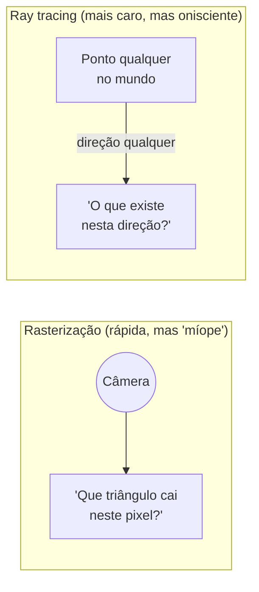
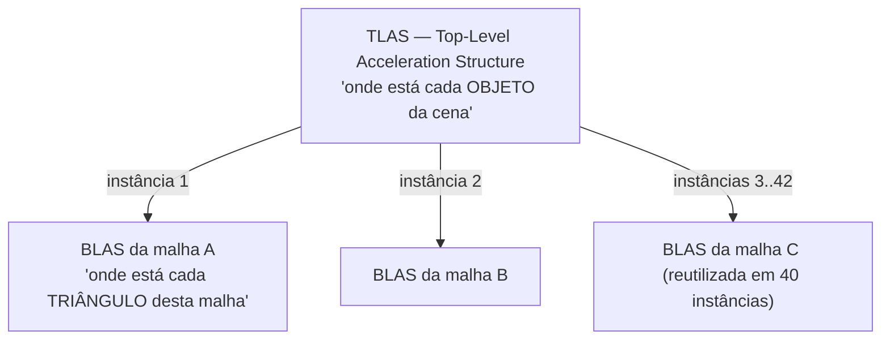
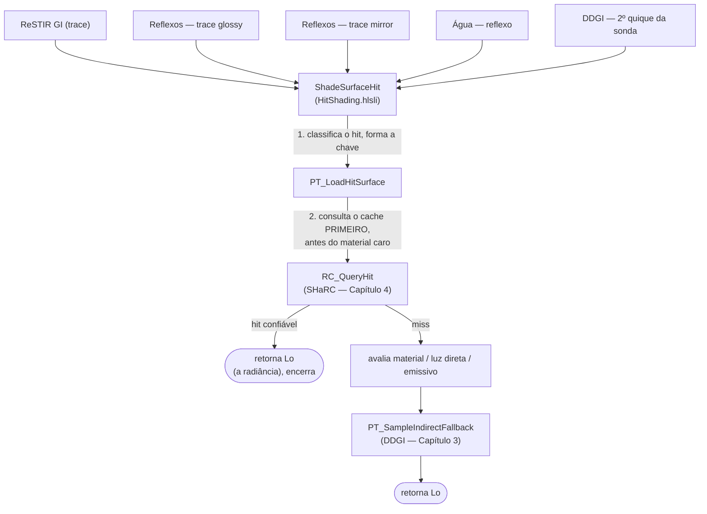
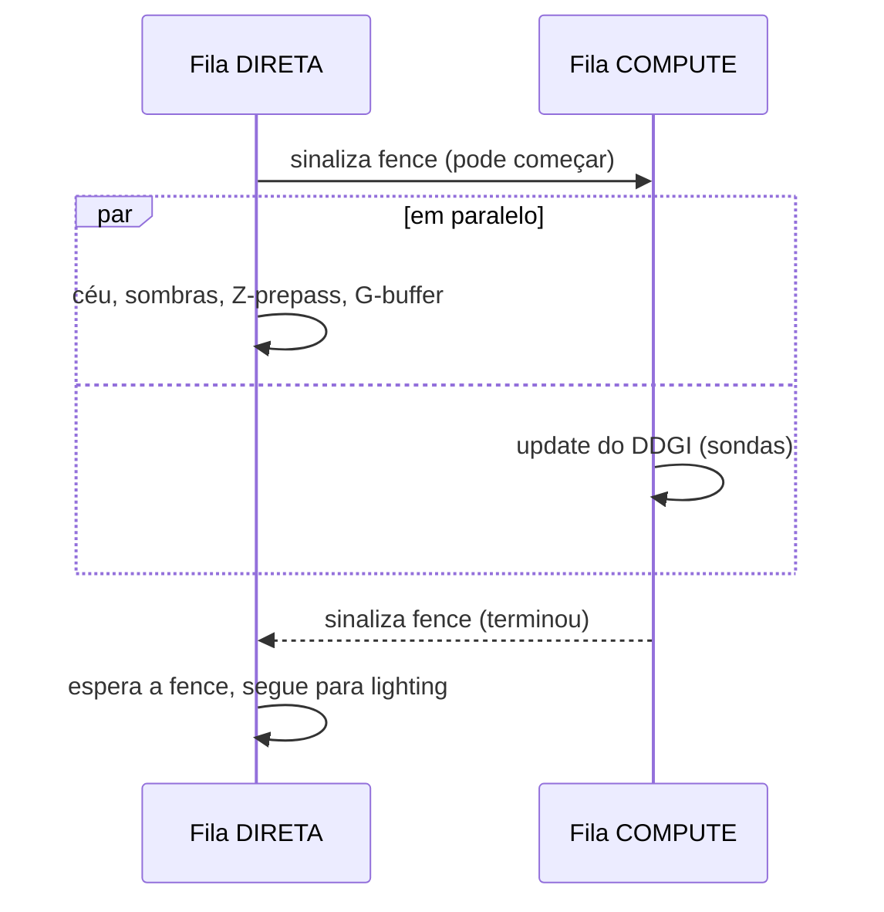

# Capítulo 2 — Ray Tracing na Smile

> [Índice](00-Indice.md) · Anterior: [Capítulo 1](01-Fundamentos-Iluminacao-Global.md) ·
> Próximo: [Capítulo 3 — DDGI](03-DDGI-Probes-De-Irradiancia.md)

Antes de entender DDGI, SHaRC ou ReSTIR, você precisa entender a peça que os três usam por
baixo: **como a Smile faz um raio perguntar "o que existe nessa direção, a partir daqui?"**
Este capítulo é sobre essa pergunta — não sobre GI ainda.

## 2.1 Rasterização vs. ray tracing, em uma frase

A Smile é, no fundo, um motor de **deferred shading rasterizado** (é assim que ela desenha
triângulos na tela — ver `Docs/ARCHITECTURE.md` §5). Rasterização é rápida porque ela
pergunta "que triângulos caem em cada pixel?" — uma pergunta que a GPU resolve em paralelo,
maciçamente, há décadas.

Mas rasterização só sabe responder "o que está bem na frente da câmera". Ela não sabe
responder "o que existe se eu sair *daquele* ponto ali, numa direção qualquer, e andar até
bater em alguma coisa?" — que é exatamente a pergunta que GI precisa fazer, de novo e de
novo, para cada quique. Essa segunda pergunta é o que **ray tracing** resolve.



A Smile usa as duas técnicas juntas: rasterização desenha a imagem "primária" (o que a
câmera vê direto — é o G-buffer, `Docs/ARCHITECTURE.md` §5.3), e ray tracing responde as
perguntas de GI a partir dali.

## 2.2 DXR 1.1 inline: ray tracing sem "sair da função"

Existem duas formas de fazer ray tracing em DirectX 12:

1. **Pipeline dedicado (DXR 1.0)**: você declara shaders especiais (`RayGeneration`,
   `ClosestHit`, `Miss`) e a GPU orquestra a troca entre eles — parecido com como o
   rasterizador troca entre vertex e pixel shader.
2. **RayQuery inline (DXR 1.1)**: você chama `TraceRayInline` **de dentro de um compute
   shader normal**, como se fosse uma função qualquer. Não há troca de shader nenhuma — o
   mesmo shader que disparou o raio também lê o resultado, na linha seguinte.

A Smile usa **só a segunda forma** (`Docs/ARCHITECTURE.md` §9: os shaders de RT são todos
`cs_6_6`, porque `RayQuery` + heap bindless (`ResourceDescriptorHeap`) exigem Shader Model
6.6). Isso simplifica muito o mental model: **um raio, na Smile, é só uma chamada de função
dentro de um compute shader.**

```hlsl
// Padrão que se repete em toda a engine (Shaders/GI/PathTracingCommon.hlsli):
RayQuery<RAY_FLAG_ACCEPT_FIRST_HIT_AND_END_SEARCH> sq;
sq.TraceRayInline(Scene, RAY_FLAG_ACCEPT_FIRST_HIT_AND_END_SEARCH, P.ShadowRayMask, sray);
sq.Proceed(); // "ande até achar algo ou esgotar o raio"
bool sombra = (sq.CommittedStatus() == COMMITTED_TRIANGLE_HIT);
```

Esse trecho é um **shadow ray**: "existe alguma coisa entre este ponto e a luz?". A flag
`RAY_FLAG_ACCEPT_FIRST_HIT_AND_END_SEARCH` diz "não preciso saber o *mais próximo*, só
preciso saber se **existe** alguma coisa" — é mais barato que um raio "completo", porque a
GPU pode parar na primeira coisa que encontrar em vez de continuar procurando algo mais
perto.

## 2.3 BLAS, TLAS: como a GPU sabe "o que existe" rapidamente

Perguntar "esse raio bate em algum dos 2 milhões de triângulos da cena?" testando triângulo
por triângulo seria absurdamente lento. A solução — usada por toda a indústria, não só pela
Smile — é uma hierarquia de caixas delimitadoras (*bounding volume hierarchy*, BVH),
organizada em dois níveis:



- **BLAS** (*Bottom-Level*): a estrutura de aceleração de **uma malha** — construída uma vez
  por malha única, não por instância. Uma floresta com 500 árvores idênticas tem **uma**
  BLAS, referenciada 500 vezes.
- **TLAS** (*Top-Level*): a lista de **instâncias** (posição, rotação, escala de cada objeto
  na cena), cada uma apontando para uma BLAS.

Na Smile, isso é `FRaytracingScene` (`Engine/Include/Smile/Graphics/RayTracing/RaytracingScene.h`).
Pontos que valem a pena guardar:

- Todas as BLAS vivem **suballocadas num único buffer** já compactado (`BlasPool`) — em vez
  de um recurso GPU por malha, o que seria centenas de alocações pequenas.
  - A TLAS é **reconstruída** (não "atualizada in-place") sempre que uma transform muda ou
  uma instância aparece/desaparece — é a recomendação da própria NVIDIA/Microsoft para esse
  caso, em vez do refinamento incremental (`RecordTlasRebuild`).
- Um objeto oculto no *outliner* do editor não é "escondido visualmente" — ele **sai da
  TLAS**. Isso significa que ele literalmente para de existir para qualquer raio (inclusive
  os de GI), não só para a rasterização.

## 2.4 `InstanceGeo`: o que um raio "vê" quando acerta algo

Um raio, sozinho, só sabe dizer "bati em algo a X metros de distância, no triângulo Y da
instância Z". Ele não sabe, por si só, qual é a cor daquela superfície, ou se ela é
metálica, ou o que fazer a seguir. Essa informação vem de um snapshot chamado
**`InstanceGeo`**: uma tabela, indexada pelo `InstanceID` (o Z do parágrafo anterior), que
guarda — por instância — os slots **bindless** dos buffers de vértice/índice e das texturas
de material daquela malha.

> **Bindless**, aqui, quer dizer: em vez de "amarrar" (bind) uma textura específica a um
> slot fixo antes de desenhar (o jeito clássico), a GPU consegue indexar **qualquer**
> textura do heap gigante e compartilhado (`FTextureSRVHeap`, 16384 slots — ver
> `Docs/ARCHITECTURE.md` §4) usando só um número inteiro. Isso é o que permite que um shader
> de compute genérico, sem saber de antemão qual objeto vai encontrar, ainda assim leia a
> textura certa depois de um `TraceRayInline`.

Este snapshot é consumido por **todo** sistema que faz ray tracing na engine: DDGI, ReSTIR
GI/DI, reflexões, mesh lights, o motion vector temporal, o visualizador de BVH e — desde a
série do SHaRC — o próprio updater do radiance cache. É por isso que ele mora em
`FRaytracingScene` e não dentro de um sistema específico como o DDGI: sete consumidores
diferentes dependem dele, e nenhum deveria precisar esperar "o volume DDGI existir" só para
ler geometria.

## 2.5 Máscaras de raio: nem todo raio "vê" a mesma coisa

Cada instância na TLAS carrega **uma categoria** (`RTMasks.h`):

| Máscara | Quando uma instância entra nela |
|---|---|
| `kRTMaskOpaque` | Geometria opaca comum |
| `kRTMaskAlphaTest` | Folhagem, cercas — opacidade testada por textura (alpha cutout) |
| `kRTMaskTranslucent` | Vidro e afins |

E cada **passe** escolhe, no momento de disparar o raio, quais categorias ele quer
enxergar — combinando bits:

- `kRTMaskGather = Opaque | AlphaTest` — usado pelo raio de "para onde a luz indireta vai" (o
  *gather*): tudo, menos vidro (vidro deixando luz passar de um jeito fisicamente correto é
  um problema à parte, que a engine escolhe não resolver aqui).
- `kRTMaskShadowFast = Opaque` — sombra "rápida": ignora folhagem de propósito, porque testar
  alpha em cada folha custa caro e o ganho visual é pequeno para sombra de segundo quique.
- `kRTMaskShadowFull = Gather` — sombra "completa": folhagem faz sombra via alpha-test.

Isso é literalmente **o mesmo raio**, com a mesma origem e direção, "vendo" cenas diferentes
dependendo de qual máscara o passe escolheu — é assim que a engine equilibra qualidade
contra custo sem duplicar código de traçado.

## 2.6 `ShadeSurfaceHit`: o funil por onde todo raio secundário passa

Aqui está a peça mais importante deste capítulo para entender os próximos três. Quando um
raio secundário (de GI) **bate** em alguma superfície, existe **uma função só**,
`ShadeSurfaceHit` (`Shaders/GI/HitShading.hlsli`), que decide o que fazer com esse hit. Ela é
chamada por **cinco traces diferentes**:



Por que isso importa tanto? Porque significa que **a política de "quem responde no fim de
um raio" é decidida em um lugar só**, e todo consumidor herda a mesma decisão
automaticamente. O comentário do próprio arquivo trata isso como **contrato**: consultar o
cache **antes** do material caro não é um detalhe de performance opcional — é a ordem que
garante que hits "confiáveis" nunca pagam o custo de avaliar BRDF, luz direta e emissivo à
toa.

Este é o mesmo motivo pelo qual, no Capítulo 6, você vai ver que trocar a política de
*fallback* (de DDGI para preto, por exemplo) afeta simultaneamente ReSTIR GI, as três
variantes de reflexo **e** o segundo quique das sondas — porque todos os cinco passam pelo
mesmo funil.

## 2.7 Filas de GPU: por que o DDGI roda "escondido"

A GPU da Smile expõe três filas de trabalho independentes (`Docs/ARCHITECTURE.md` §4):

| Fila | Tipo D3D12 | Papel |
|---|---|---|
| `FCommandQueue` | DIRECT | o frame "normal": raster, sombras, G-buffer, lighting... |
| `FUploadQueue` | COPY | upload de texturas/malhas, sem travar o frame |
| `FAsyncComputeQueue` | COMPUTE | o **update do DDGI**, rodando em paralelo com o raster |

O update das sondas do DDGI (Capítulo 3) é puro trabalho de compute — não depende do
G-buffer nem do resultado do raster. Então a engine o dispara na fila de **compute
assíncrona**, ao mesmo tempo em que a fila direta desenha céu, sombras, Z-prepass e
G-buffer. Se as duas filas terminarem dentro da mesma janela de tempo, o update do DDGI é
efetivamente **de graça** — ele "se esconde" atrás de trabalho que já ia acontecer mesmo.



Isso não é grátis de verdade, no sentido estrito — as duas filas competem por unidades de
execução (SMs) e banda de memória dentro da mesma GPU física. Mas, na prática medida (ver
`Docs/DDGI-AUDIT.md`), a fila direta frequentemente nem chega a **esperar** — o compute
termina antes de ser necessário.

## 2.8 O que fica para os próximos capítulos

Você já sabe:

- Como um raio nasce (`TraceRayInline`), o que ele "vê" (máscaras) e como ele descobre o que
  encontrou (`InstanceGeo`).
- Que existe um funil único (`ShadeSurfaceHit`) por onde **todo** raio secundário passa, e
  que dentro dele a primeira pergunta é sempre "o cache de radiância (SHaRC) sabe
  responder?", com o DDGI como plano B.
- Que parte desse trabalho roda escondido numa fila de GPU separada.

Os próximos dois capítulos abrem, um de cada vez, os dois sistemas que respondem "qual é a
luz aqui": primeiro o mais simples e estável (DDGI), depois o mais fino e caro de aquecer
(SHaRC).

Siga para o [Capítulo 3 — DDGI](03-DDGI-Probes-De-Irradiancia.md).
