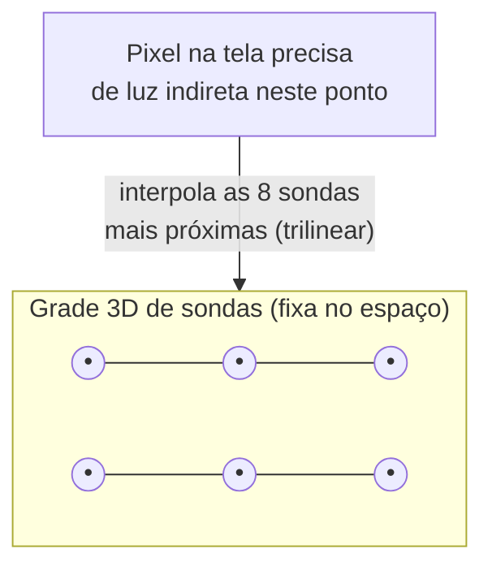
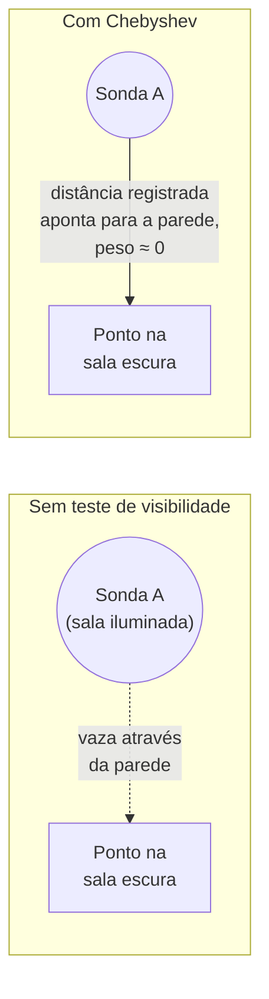
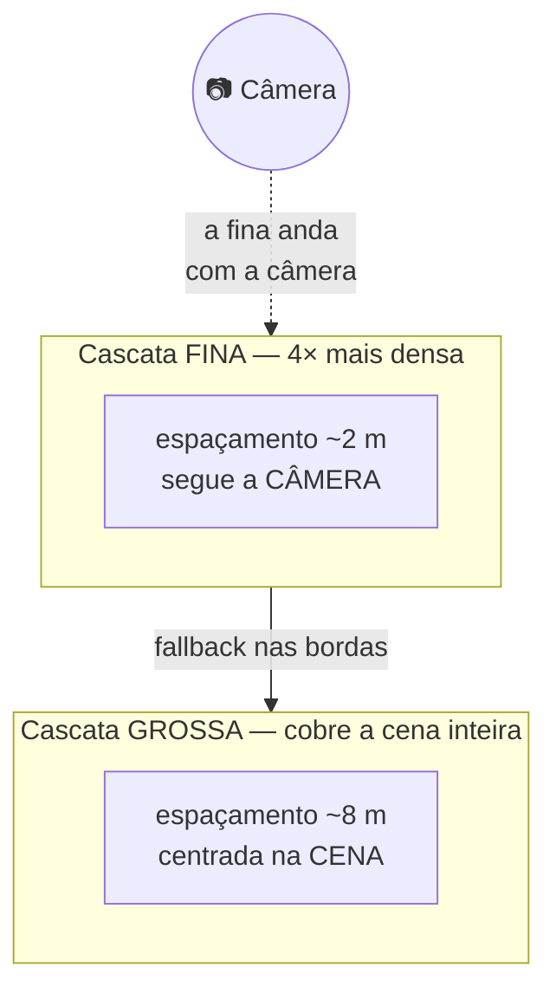

# Capítulo 3 — DDGI: Sondas de Irradiância

> [Índice](00-Indice.md) · Anterior: [Capítulo 2](02-Ray-Tracing-Na-Smile.md) ·
> Próximo: [Capítulo 4 — SHaRC](04-SHaRC-Radiance-Cache.md)

DDGI significa **Dynamic Diffuse Global Illumination** — o paper original é de Majercik et
al., publicado no *Journal of Computer Graphics Techniques* em 2019. Na Smile ele vive em
`Engine/Include/Smile/Graphics/GI/DDGI.h` e nos shaders de `Shaders/GI/DDGI*.hlsl`. Este é o
sistema mais **estável** da engine: sempre presente, cobre a cena inteira, e é o alicerce
sobre o qual tudo o resto (SHaRC, ReSTIR) se apoia como fallback.

## 3.1 A ideia central, em uma analogia

Imagine espalhar centenas de pequenas "câmeras 360°" invisíveis dentro da cena, numa grade
regular — uma a cada poucos metros. Cada uma dessas câmeras não tira uma foto normal: ela
soma "quanta luz chega até aqui, vinda de cada direção" e guarda só um resumo comprimido
disso (a **irradiância**). Essas câmeras são as **sondas** (*probes*).

Quando, mais tarde, um pixel qualquer da tela precisa saber "quanta luz indireta chega
aqui?", a engine não traça um raio para descobrir do zero — ela olha para as sondas mais
próximas daquele ponto e **interpola** entre elas. É rápido porque a parte cara (traçar
raios de verdade) já foi feita, uma vez, para cada sonda — não uma vez por pixel.



## 3.2 O que cada sonda guarda: dois atlas, não um

Cada sonda guarda **duas** informações, em duas texturas separadas (chamadas de "atlas"
porque muitas sondas são empacotadas lado a lado numa textura única, como um mapa de
retalhos):

1. **Atlas de irradiância**: um pequeno quadrado de `6×6` texels (`kTileSize = 6`) por
   sonda, guardando a luz vinda de cada direção, comprimida via **mapeamento octaédrico**.
2. **Atlas de distância**: um quadrado de `14×14` texels (`kDistTileSize = 14`) por sonda,
   guardando **até que distância** existe geometria em cada direção — junto com a variância
   dessa distância. É esta segunda textura que resolve o problema mais famoso das técnicas
   de sondas: **vazamento de luz** (*light leaking*).

### Mapeamento octaédrico: guardar "todas as direções" num quadrado

Uma esfera de direções não cabe naturalmente numa textura 2D. A solução clássica (usada
também pela Flax, pela UE e pelo RTXGI) é o **mapeamento octaédrico**: projetar a esfera
sobre as faces de um octaedro e depois "abrir" o octaedro num quadrado plano.

```hlsl
// Shaders/GI/DDGICommon.hlsli
float2 DDGI_OctEncode(float3 n) {
    n /= (abs(n.x) + abs(n.y) + abs(n.z));
    float2 o = (n.z >= 0.0f) ? n.xy : ((1.0f - abs(n.yx)) * sign(n.xy));
    return o;
}
```

Não precisa decorar a fórmula — o que importa é a ideia: **qualquer direção 3D vira duas
coordenadas 2D**, e por isso uma "foto 360°" cabe num quadrado de textura pequeno.

### O problema do vazamento de luz, e como o atlas de distância resolve

Imagine uma sonda de um lado de uma parede fina, e o pixel que está consultando essa sonda
do **outro** lado da parede. Se a engine só interpolasse a irradiância pela distância, ela
"vazaria" luz através da parede — a sonda do lado errado contribuiria com luz para um lugar
que, na realidade, está em sombra.

A solução é o **teste de Chebyshev** (também da literatura de *shadow mapping* de variância —
VSM): cada sonda também sabe, para cada direção, **a que distância está o objeto mais
próximo** (a média) e **a variância** dessa distância. Se o ponto que está pedindo luz está
*mais longe* do que a sonda "enxerga" naquela direção, a engine reduz drasticamente o peso
daquela sonda:

```hlsl
// Shaders/GI/DDGICommon.hlsli — a essência do teste
if (tap.DistToProbe > tap.Mean) {
    float variance = abs(tap.Mean * tap.Mean - tap.Mean2);
    float d        = tap.DistToProbe - tap.Mean;
    float cheb     = variance / max(variance + d * d, 1e-8f);
    tap.Visibility = max(cheb * cheb * cheb, 0.05f);
    w *= tap.Visibility;
}
```

Em palavras: "se a distância que eu preciso é maior do que a distância que essa sonda
consegue ver sem obstrução, ela provavelmente está vendo através de uma parede — deio menos
peso a ela". Isso é exatamente o mecanismo que impede a luz de "vazar" para o outro lado de
uma parede fina.



## 3.3 Como cada sonda "aprende" a luz: 64 raios Fibonacci

A cada frame (ou a cada poucos frames — Seção 3.5), cada sonda dispara até **64 raios**
(`kRaysPerProbe = 64`), espalhados pela esfera inteira usando uma **espiral de Fibonacci**
— uma forma de distribuir N pontos numa esfera de maneira quase perfeitamente uniforme, sem
aglomerações nos polos (o problema clássico de grades lat/long).

```hlsl
float3 DDGI_SphericalFibonacci(float i, float n) {
    const float PHI = 1.61803398875f; // razão áurea
    float phi = 2.0f * SMILE_PI * frac(i * (PHI - 1.0f));
    float cosTheta = 1.0f - (2.0f * i + 1.0f) / n;
    float sinTheta = sqrt(saturate(1.0f - cosTheta * cosTheta));
    return float3(cos(phi) * sinTheta, sin(phi) * sinTheta, cosTheta);
}
```

Para evitar que o **mesmo** padrão de 64 direções se repita frame após frame (o que criaria
artefatos visíveis, tipo um "carimbo" fixo), a engine **rotaciona** o padrão inteiro, de
forma diferente a cada frame **e** a cada sonda (`DDGI_RandomRotation`). Isso espalha o erro
de amostragem como ruído aleatório em vez de um padrão repetitivo — o mesmo princípio por
trás de quase toda técnica de *ray tracing* em tempo real.

Cada um desses 64 raios é traçado (Capítulo 2) e, quando bate em algo, passa pelo mesmo
`ShadeSurfaceHit` — ou seja, **o segundo quique de uma sonda de DDGI consulta o SHaRC**
(Capítulo 4) exatamente como qualquer outro raio secundário da engine. É assim que a luz
"realimenta": a sonda A ilumina a sonda B, que ilumina a sonda C, e por aí em diante, ao
longo de vários frames.

## 3.4 Acumulação temporal: por que a imagem não "pisca"

64 raios por sonda é pouco para uma estimativa "limpa" — sozinho, o resultado seria ruidoso.
A solução é **acumular ao longo do tempo**: em vez de substituir o valor da sonda a cada
frame, a engine faz uma média móvel exponencial:

```
novo_valor = lerp(valor_antigo, valor_deste_frame, 1 − histerese)
```

Com `Hysteresis = 0.98` (o teto, `kHysteresisMax`), cada frame novo contribui só 2% para o
resultado — leva dezenas de frames para a sonda "convergir" completamente, mas o resultado
final é estável e sem ruído visível, porque o ruído de frames diferentes se cancela.

⚠️ **A pegadinha que a auditoria interna encontrou** (`Docs/DDGI-AUDIT.md`): sem um
tratamento especial, uma sonda **recém-criada** (valor zero) levaria ~300 frames (5 segundos
a 60 FPS) convergindo a partir do preto — a cena nasceria escura e clarearia sozinha aos
olhos do jogador. A correção foi um **reset "one-shot"**: no primeiro update depois de uma
cena carregar, a sonda **substitui** o valor em vez de misturar. Esse é o tipo de detalhe
que separa "funciona na teoria" de "funciona sem ninguém notar".

O atlas de **distância** usa uma histerese própria e mais alta (`kDistHysteresis = 0.99`) —
porque a distância + variância definem o teste de Chebyshev da Seção 3.2, e um teste de
visibilidade "tremendo" entre frames seria mais perceptível que uma irradiância tremendo.

## 3.5 Relocação: o que fazer quando uma sonda nasce dentro de uma parede

A grade de sondas é regular — mas o mundo não é. É perfeitamente comum uma sonda "nascer"
matematicamente dentro de uma parede, dentro do chão, ou dentro de um objeto. Uma sonda
enterrada é inútil (tudo que ela vê é o interior de um sólido).

A **relocação** (`Relocation`, ligada por padrão) resolve isso deslocando cada sonda, pouco
a pouco ao longo de vários frames, para longe da geometria — sem sair da própria "célula" da
grade. É um processo de convergência lenta (até `kRelocateConvergeFrames = 180` frames),
não um teleporte instantâneo.

Junto com a relocação vem a **classificação**: cada sonda também decide, a partir do que os
64 raios encontraram, se está **ativa** (pertence a uma região relevante da cena) ou
**inativa** (por exemplo, permanentemente enterrada demais para ser útil) — e quantos raios
ela realmente precisa por frame daqui para frente (Seção 3.7).

## 3.6 O bias de superfície: um detalhe pequeno com consequência grande

Quando um pixel consulta as sondas ao seu redor, a posição usada para a consulta não é
exatamente a posição da superfície — ela é deslocada um pouco na direção da normal (o
**bias**), para evitar que a própria superfície "se auto-sombra" no teste de Chebyshev
(imprecisão de ponto flutuante faria a superfície se enxergar como um obstáculo dela mesma).

A auditoria interna (`Docs/DDGI-AUDIT.md`) documentou um caso real de como esse número pode
sair errado silenciosamente: o bias era calculado como uma fração do espaçamento da grade
(`0,75 · spacing · 0,2`). Numa cena com sondas a **8 metros** de distância uma da outra, isso
dava um bias de **1,2 metros** — grande o bastante para o próprio bias "vazar" luz através de
paredes finas, o problema oposto do que ele deveria prevenir. A correção foi um **teto
absoluto em metros** (`SurfaceBiasMax = 0.40`), independente do espaçamento da grade —
porque uma parede tem a mesma espessura física não importa quão espaçadas estejam as sondas.

## 3.7 Raios adaptativos: nem toda sonda precisa de 64 raios

Uma sonda em ar livre, no meio de uma sala grande, provavelmente já "convergiu" bem com
poucos raios — continuar gastando 64 raios nela todo frame é desperdício. `AdaptiveRays`
(ligado por padrão) deixa cada sonda pedir entre `MinRays = 16` e `MaxRays = 64` raios,
conforme o quão "difícil" (geometricamente complexa) a região ao redor dela parece ser.

Medido na cena de referência (Bistro, `Docs/DDGI-AUDIT.md`, 19/08/2026): com a câmera
**andando**, isso reduziu o tempo do update do DDGI em ~5% e o frame de GPU em ~1,6% no p95
— um ganho real, mas modesto, e **não** um substituto para reduzir o número de sondas.

## 3.8 Cascatas: uma grade grossa não basta para tudo

Uma única grade de sondas cobrindo a cena inteira precisa ter espaçamento grande (na cena de
referência, ~8 metros) só para caber num orçamento de memória e desempenho razoável. Mas 8
metros de espaçamento é grosseiro demais perto da câmera — é aí que o vazamento de luz e a
falta de detalhe ficam mais visíveis aos olhos do jogador.

A solução: **cascatas**. Em vez de uma grade só, a engine mantém até `kMaxCascades = 4`
grades sobrepostas, cada uma mais fina que a anterior:



Cada cascata mais fina cobre `kCascadeSpacingRatio = 4` vezes menos espaço que a anterior,
com o mesmo número de sondas — ou seja, 4× mais densidade. **A cascata mais grossa é o
volume "de sempre"**, cobrindo a cena inteira; as finas entram só *dentro* dela, e a
transição entre uma cascata fina e a grossa é suavizada (*blend*) nas últimas ~2,5 células
de cada uma.

### Scrolling toroidal: a cascata fina "anda" sem recalcular tudo

A cascata fina segue a câmera — mas recriá-la do zero toda vez que a câmera anda um metro
seria caríssimo (perderia toda a convergência acumulada). A solução é **scrolling
toroidal**: a grade de sondas continua com o mesmo número de sondas fixo, mas cada sonda
"embrulha" para o lado oposto quando a janela desliza — como uma esteira, ou como o mundo em
jogos antigos que "dá a volta" na tela.

```hlsl
// Shaders/GI/DDGICommon.hlsli
int3 DDGI_StorageCoord(int3 c, int3 scroll, int3 count) {
    int3 s = c + scroll;
    return s - count * (int3)(s >= count);   // "embrulha" ao passar do fim
}
```

O invariante importante aqui, registrado na auditoria: **uma sonda de coordenada geométrica
fixa no mundo nunca troca de posição de armazenamento (slot) enquanto a janela desliza** — só
as "lâminas" (fileiras) recém-expostas nas bordas viram conteúdo novo, que precisa ser
re-traçado do zero. Isso é o que faz o scrolling ser barato: a maior parte do conteúdo
simplesmente continua válida, só desloca de posição lógica.

**Custo medido** (`Docs/DDGI-AUDIT.md`, Bistro, RTX 3060 Ti): a segunda cascata custa
**+0,83 ms** de frame de GPU parada (+10,8%) e **+1,43 ms** (+6%) com a câmera andando —
pago em troca de reduzir visivelmente o vazamento de luz residual que motivou a auditoria
inteira. A conclusão registrada: "os 0,83 ms compram a correção do defeito que motivou a
série inteira, e o sistema segue folgado para 60 fps."

## 3.9 Os três papéis do DDGI (voltamos a este ponto no Capítulo 6)

Vale adiantar aqui, porque conecta este capítulo ao 4 e ao 6: mesmo quando o SHaRC é a fonte
**primária** de GI de superfície (o padrão da engine hoje), o DDGI nunca fica ocioso. Ele
cumpre **três papéis** simultâneos:

1. **Fallback dos raios secundários**: quando o SHaRC erra ou está "frio" (Capítulo 4), é o
   DDGI que responde no lugar, dentro do `ShadeSurfaceHit` do Capítulo 2.
2. **Auxiliar de superfície**: folhagem, *subsurface scattering* e objetos translúcidos
   (`ForwardBlend`) sempre leem o atlas do DDGI diretamente — o SHaRC não tem substituto para
   esses três casos, porque ele é "cego de direção" (guarda uma média, não um campo de luz
   por direção como o DDGI).
3. **Fonte da névoa volumétrica**: o *volumetric fog* sempre lê o atlas de irradiância do
   DDGI, porque o SHaRC não tem estrutura equivalente para meio participante (a "névoa" em
   si, não superfícies).

## 3.10 Resumo do capítulo

| Conceito | O que resolve |
|---|---|
| Grade de sondas | Amostra a luz da cena uma vez, reusa por milhões de pixels |
| Atlas octaédrico | Guarda "toda direção" num quadrado de textura pequeno |
| Atlas de distância + Chebyshev | Evita vazamento de luz através de paredes finas |
| Fibonacci + rotação por frame | Distribui 64 raios uniformemente, sem padrão repetido |
| Histerese / acumulação temporal | Troca ruído por estabilidade ao longo de vários frames |
| Relocação | Tira sondas de dentro de geometria sólida |
| Bias de superfície com teto | Evita auto-sombra sem reabrir vazamento em paredes finas |
| Raios adaptativos | Gasta menos raios onde a sonda já "sabe a resposta" |
| Cascatas + scrolling toroidal | Mais densidade perto da câmera sem perder convergência |

Siga para o [Capítulo 4 — SHaRC](04-SHaRC-Radiance-Cache.md), onde o segundo pilar do
sistema — mais fino, mais caro de aquecer, e hoje a fonte *primária* de GI — é explicado com
o mesmo nível de detalhe.
