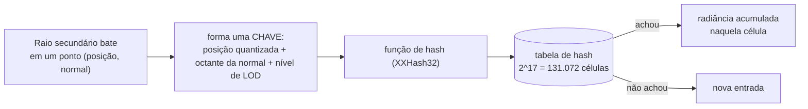
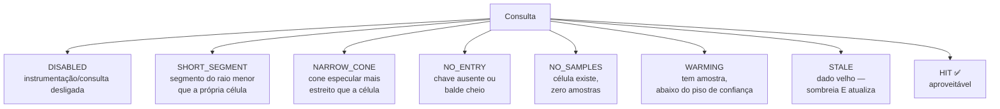
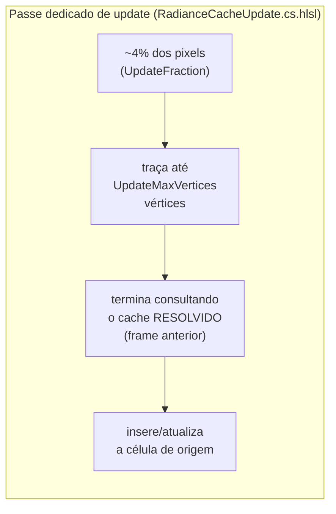
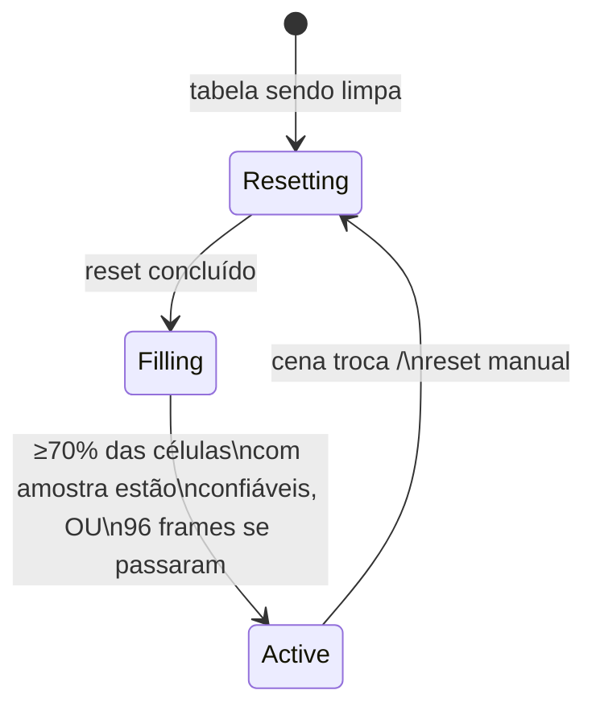

# Capítulo 4 — SHaRC: o Radiance Cache em Espaço de Mundo

> [Índice](00-Indice.md) · Anterior: [Capítulo 3 — DDGI](03-DDGI-Probes-De-Irradiancia.md) ·
> Próximo: [Capítulo 5 — ReSTIR, DI, GI e ReGIR](05-ReSTIR-DI-GI-ReGIR.md)

SHaRC significa **Spatial Hashing Radiance Cache** — a técnica publicada pela NVIDIA em
2023/2024 e usada, por exemplo, no *Cyberpunk 2077: Overdrive*. A implementação da Smile
também bebe de dois papers acadêmicos que o próprio código cita: **Gautron 2020** ("Real-Time
Global Illumination Using Spatial Hashing") e **Sousa 2025** — mais o SDK público de
referência da SHaRC. Na engine ele é a classe `FRadianceCache`
(`Engine/Include/Smile/Graphics/GI/RadianceCache.h`), e é hoje a **fonte primária** de GI de
superfície (`Docs/SHARC-PRIMARY-GI-PLAN.md`, Fase 5).

Se o Capítulo 3 (DDGI) foi sobre "amostrar a cena numa grade fixa de pontos", este capítulo é
sobre uma ideia diferente: **guardar radiância indexada por posição no mundo, numa tabela de
hash — sem sondas fixas, sem grade explícita.**

## 4.1 A ideia central: uma tabela de hash sobre o mundo 3D

Pense num dicionário gigante onde a **chave** é "aproximadamente esta posição 3D, com esta
normal" e o **valor** é "a última radiância medida ali". Toda vez que um raio de GI passa
por um ponto do mundo, ele pode:

- **Consultar** o dicionário: "já sei a resposta para esta região?"
- **Inserir/atualizar** o dicionário: "acabei de medir a resposta aqui, vou guardar."

Isso é o SHaRC. A diferença fundamental para o DDGI é que **não existe grade fixa de
posições pré-determinadas** — qualquer ponto do mundo pode virar uma entrada na tabela,
sob demanda, conforme a câmera e os raios visitam aquela região.



## 4.2 A chave: por que "posição" sozinha não basta

Se a chave fosse só a posição 3D quantizada, os dois lados de uma parede fina cairiam **na
mesma célula** — um absurdo fisicamente (um lado pode estar ao sol e o outro na sombra).
A chave da Smile combina três coisas (`RC_HashKey`, `Shaders/GI/RadianceCache.hlsli`):

```hlsl
const int3  posInt = (int3)floor(samplePos / cellSize);
const uint normalBits = (sampleNormal.x >= 0.0f ? 1u : 0u)
                      | (sampleNormal.y >= 0.0f ? 2u : 0u)
                      | (sampleNormal.z >= 0.0f ? 4u : 0u);
const uint4 key = uint4(posInt.x, posInt.y, posInt.z, level | (normalBits << 8));
```

1. **Posição quantizada** em células de tamanho `cellSize` (Seção 4.3).
2. **Octante da normal** — só 3 bits (8 combinações), que bastam para separar "faces
   opostas" sem fragmentar uma superfície curva (uma esfera, por exemplo) em dezenas de
   células instáveis, um problema citado explicitamente da literatura do SHaRC (Listing 7.6
   do paper de referência).
3. **Nível de LOD** — Seção 4.3.

A chave passa por uma função de hash (`XXHash32`, um algoritmo rápido e bem distribuído) que
vira o **slot** onde procurar na tabela, e uma **segunda** função de hash (sobre as mesmas
coordenadas, mas "embaralhadas" com a constante `0x9E3779B9`, a razão áurea de Knuth) que
vira o **checksum** — um segundo número guardado junto, usado para confirmar "esta é
realmente a célula que eu procurava" e não uma colisão de hash acidental.

## 4.3 Células que crescem com a distância (LOD)

Uma parede a 100 metros de distância não precisa da mesma resolução espacial que uma parede
a 1 metro — do contrário, a tabela de hash teria que representar toda a cena na resolução
mais fina, gastando memória à toa em coisas que o jogador mal distingue. A solução é um
**nível de detalhe (LOD)** que cresce com a distância à câmera, dobrando de tamanho a cada
"degrau":

```hlsl
uint RC_GridLevel(float3 samplePos, float3 cameraPos, float lodDistance) {
    const float d = length(cameraPos - samplePos);
    return (uint)max(floor(log2(1.0f + d / max(lodDistance, 1e-3f))), 0.0f);
}
float RC_CellSize(uint level, float baseCellSize) {
    return baseCellSize * exp2((float)level); // dobra a cada nível
}
```

`BaseCellSize` (o tamanho no nível 0, colado na câmera) começou em **0,25 m** — o valor de
referência do idTech 8 (o motor do *DOOM Eternal*), citado no código como ponto de partida.
Mas o valor **atual em produção é 0,50 m**, e a mudança é um exemplo direto de "a régua de
medição corrigiu a estimativa inicial": o par antigo `(0,25 m, LodDistance = 12 m)` saturava
**95,2%** da tabela de hash na cena de referência — ocupação alta demais para medir custo com
confiança (qualquer teste de capacidade, Seção 4.5, ficaria sempre no limite). Recalibrado
para `(0,50 m, LodDistance = 6 m)`, a ocupação medida caiu para **22,8%** — dentro da faixa
saudável. ⚠️ Se você ler `0,25 m` em algum lugar do código ou de uma auditoria antiga, é o
valor histórico/de referência, não o default atual.

## 4.4 Colisões: tabela de hash aberta com "baldes"

Duas chaves diferentes podem, por azar, cair no mesmo slot (**colisão de hash**). A Smile
resolve isso com **endereçamento aberto**: se o slot já está ocupado por outra chave, ela
tenta o próximo, e o próximo, até um limite (`RC_BUCKET_SIZE`, o tamanho do "balde"). A
função de busca (`RC_Find`) para a busca assim que encontra um slot **vazio de verdade**
(nunca usado) — porque, se a chave existisse, a inserção original teria parado ali também.

Um detalhe sutil, documentado no próprio código, é a diferença entre um slot **vazio** e um
**tombstone** (uma entrada que já existiu mas foi despejada/reciclada): a busca **não** pode
parar num tombstone, porque pode haver uma colisão viva mais adiante na cadeia que só foi
inserida depois do despejo.

A inserção é **atômica** (`RC_Insert`, via *compare-and-swap*), porque múltiplas threads da
GPU podem tentar inserir chaves diferentes no mesmo instante. Ela distingue dois tipos de
falha, que pedem correções **opostas** — um dos achados mais interessantes documentados no
plano de implementação (`Docs/SHARC-PRIMARY-GI-PLAN.md`, Fase 4):

| Falha | Significa | Correção |
|---|---|---|
| `RC_INSERT_FULL` | A cadeia inteira (o balde) já está ocupada por **outras** chaves | Tabela maior, ou células maiores (LOD mais agressivo) |
| `RC_INSERT_CONTENDED` | Perdeu 32 disputas de CAS seguidas **no mesmo balde**, mesmo com a tabela longe de cheia | É concorrência entre threads do mesmo frame — aumentar a tabela **não ajuda em nada** |

Medir os dois separadamente evitou um erro clássico: se fossem um contador só, alguém
poderia "resolver" um problema de concorrência aumentando a tabela sem que isso mudasse
nada — e a métrica pareceria melhorar por coincidência estatística, escondendo a causa real.

## 4.5 O tamanho da tabela: por que 2¹⁷ e não 2²⁰

A capacidade é sempre uma **potência de 2** (`kDefaultCapacityLog2 = 17` → 131.072 células,
~4,5 MB), porque isso permite trocar uma divisão por uma máscara de bits (`hash &
(capacity - 1)`) — muito mais barato numa GPU.

A escolha de **17** e não, digamos, **20**, é um caso real e bem documentado de "a estimativa
inicial estava errada, e a régua de medição corrigiu": a capacidade tinha sido calculada
quando **todo raio secundário do render** inseria na tabela. Depois que um **passe dedicado
de atualização** (Seção 4.7) passou a ser o único produtor, escrevendo em só ~4% dos pixels
por frame, a ocupação real caiu quase duas ordens de grandeza — de ~2,4% (praticamente
vazia, com 2²⁰) para uma faixa saudável. `2¹⁷` foi escolhido por ser o único valor, entre as
potências de 2 candidatas, em que **nem o cenário "leve" nem o "pesado"** erra por mais de um
ponto percentual da faixa-alvo de ocupação (20–70%) — e ele erra sempre para o lado barato
(desperdiçar um pouco de memória é preferível a estourar a tabela e perder amostras).

## 4.6 Confiança: uma amostra não é o suficiente para "responder"

Até uma correção específica (documentada como Fase 4 do plano), a regra para uma célula
poder **encerrar** um caminho de raio era simplesmente "ela tem pelo menos uma amostra". O
problema: uma célula com **uma única amostra** de path tracing (inerentemente ruidosa) seria
tratada como se fosse radiância convergida, e essa amostra ruidosa passaria a ser servida
para **todo** raio que caísse naquela célula nos frames seguintes.

A correção foi um **piso de confiança** (`MinSampleCount`, padrão 4): uma célula só pode
**encerrar** um caminho (responder "aqui está a luz, pode parar de traçar") depois de
acumular pelo menos `MinSampleCount` amostras. Abaixo disso, ela devolve o status
`RC_QUERY_WARMING` — "eu existo, mas ainda não confio em mim mesma".

O resultado da medição (`Docs/SHARC-PRIMARY-GI-PLAN.md`, Fase 4) é um exemplo elegante de
contabilidade que **fecha exatamente**: subir o piso de 1 para 4 custou 0,262 pontos
percentuais de taxa de acerto — e **cada um** desses pontos perdidos foi rastreado até uma
célula específica que estava "fresca, mas abaixo do piso". Nada sobrou sem explicação.

### Os sete estados de uma consulta

Cada consulta ao cache devolve um de sete estados possíveis, e cada um significa uma coisa
diferente e pede uma ação diferente de quem chamou:



`SHORT_SEGMENT` e `NARROW_CONE` merecem nota: eles significam "esta consulta nem faz
sentido geometricamente" — um raio muito curto pediria, na prática, para a célula responder
sobre si mesma (auto-referência), e um cone especular muito estreito (uma reflexão quase
espelhada) perderia precisão de direção se fosse resolvido pela radiância *média* que a
célula guarda (lembre: o SHaRC não guarda direção, só uma média). Medido na cena de
referência, essas duas categorias somam **~30% de todas as consultas** — um piso de
geometria que nenhum ajuste de capacidade ou aquecimento consegue mover, porque não é um
problema de "a tabela não sabe" e sim "a pergunta não é apropriada para este tipo de
estrutura".

## 4.7 O produtor dedicado: um mini path tracer alimentando o cache

Aqui está talvez a parte mais interessante do SHaRC na Smile: quem **alimenta** a tabela não
são (mais) os raios de render — é um **passe de compute dedicado**, que roda uma vez por
frame, disparando **path tracing de verdade** (múltiplos quiques, terminando em outro lookup
do próprio cache) sobre uma fração pequena da tela.



Por que **não** deixar todo raio de render alimentar a tabela (como acontecia antes deste
passe existir)? Porque um raio de render tem um objetivo diferente — responder "qual a cor
deste pixel, agora" — e amostra a cena do jeito que o pixel pede, não do jeito que a tabela
precisa para convergir de forma equilibrada. Um produtor **dedicado** permite controlar,
separadamente, **quantos vértices** cada caminho de atualização traça
(`UpdateMaxVertices`, testado entre 1 e 4) e **que fração da tela** dedicar a isso
(`UpdateFraction`, default 4% — o mesmo valor publicado pela CD Projekt Red para o
*Cyberpunk 2077*).

### Multi-bounce: o cache "realimenta" a si mesmo, ao longo do tempo

Um detalhe crucial: o caminho do updater, ao terminar, consulta o **cache resolvido do
frame anterior** (`UsePrevCacheAtTerminal`) em vez de simplesmente parar no primeiro quique.
Isso é o que transforma "um bounce por frame" em **multi-bounce ao longo do tempo** — a luz
que uma célula A aprendeu no frame N alimenta a célula B no frame N+1, que alimenta a célula
C no frame N+2, e assim sucessivamente. Desligar essa opção reduziria o cache a aprender
apenas o primeiro quique, indefinidamente — o A/B que separa, nas palavras da própria
documentação interna, "o cache funciona" de "o cache realimenta".

Medido na cena de referência: mais da metade dos caminhos de update (51,63%) termina no
próprio cache — ou seja, a realimentação temporal está **de fato acontecendo**, não é só
uma possibilidade teórica.

### `UpdateMaxVertices`: quanto vale traçar mais fundo

Um A/B cuidadoso (`Docs/SHARC-PRIMARY-GI-PLAN.md`, Fase 3) comparou `UpdateMaxVertices = 1`
(V1, o default) contra `= 4` (V4):

| | V1 | V4 |
|---|---|---|
| custo do updater | 3,75 ms | 7,73 ms (2,06×) |
| ganho de qualidade | — | +0,45% de luminância média, 44,79 dB de PSNR |

V4 custa o dobro para um ganho pequeno — porque, na cena testada (exterior, onde o caminho
escapa para o céu com frequência), o caminho médio só alcança **2 de 4** vértices possíveis
mesmo pedindo 4. A conclusão registrada é honesta sobre o limite dela: **isso é calibrado
para uma classe de cena** (exterior); um interior, onde o caminho bate mais e escapa menos,
provavelmente justificaria um valor mais alto.

### Scheduling compacto (`CompactUpdate`): o mesmo trabalho, 4,3× mais rápido

O produtor dedicado atualiza apenas ~4% dos pixels por frame (`UpdateFraction`) — mas a
primeira implementação ainda **disparava um dispatch do tamanho da tela inteira**, com cada
thread testando "eu sou um dos pixels sorteados?" e saindo cedo (*early-out*) se não fosse.
Isso desperdiça ocupação da GPU: a maioria das *waves* (grupos de threads que a GPU executa
juntos) contém uma mistura de threads "sorteadas" e "não sorteadas", e uma wave só termina
quando a última thread dela termina — então as threads que saíram cedo ficam **ociosas,
esperando** as poucas que realmente têm trabalho.

`CompactUpdate` (ligado por padrão desde a Fase 7 do plano de implementação) resolve isso
compactando **antecipadamente**, de forma analítica, os pixels sorteados dentro de cada
bloco de 5×5 do tile de atualização — de forma que as *waves* despachadas já contenham só
threads com trabalho de verdade, em vez de intercalar trabalho e ociosidade.

O resultado medido (`Docs/SHARC-PRIMARY-GI-PLAN.md`, Fase 7, 15/08/2026): o updater caiu de
**3,75 ms para 0,87 ms** — uma melhora de **4,31×** — e o tempo total de GPU do frame caiu de
15,65 ms para 12,57 ms. O A/B de imagem confirmou que nada mudou visualmente (60,33 dB de
PSNR, variação de energia de −0,00047% — dentro do ruído numérico), com ocupação e número de
amostras idênticos: é uma otimização pura de **como** o trabalho é despachado, não de **o
que** é calculado.

## 4.8 Aquecimento (warmup): a tabela precisa de tempo antes de valer a pena consultar

Uma tabela recém-criada (cena nova, ou depois de um reset) está **vazia**. Se o render
começasse a consultar imediatamente, todo raio pagaria o custo da busca só para receber
`NO_ENTRY` ou `NO_SAMPLES` — trabalho gasto sem retorno algum. `AutoWarmup` resolve isso com
uma pequena máquina de estados:



Durante `Filling`, o **render** ainda não consulta a tabela (evitando o desperdício acima),
mas o **updater** continua rodando — é assim que a tabela "enche" com multi-bounce antes da
consulta abrir, em vez de abrir cedo demais e reconverter tudo depois.

O limiar de 70% (`kWarmupConfidentRatio`) foi escolhido abaixo do regime medido em regime
permanente (80,8%) de propósito: como o produtor cria células novas o tempo todo, essa fração
tem um **teto natural menor que 100%** que depende de quanto a cena muda — um limiar colado
no teto medido de uma cena específica não dispararia de forma confiável em outra cena com
mais movimento.

## 4.9 O que o SHaRC não faz (e por que o DDGI continua existindo)

O SHaRC guarda uma **radiância média por célula**, sem informação de direção — é
"direcionalmente cego". Isso é perfeitamente adequado para GI difusa (a luz que quica e se
espalha em todas as direções aproximadamente igual), mas **não serve** para:

- **Reflexos nítidos** (espelhados ou quase): a Seção 4.6 já mostrou que `NARROW_CONE`
  rejeita essas consultas de propósito.
- **Meio participante** (névoa volumétrica): não existe uma estrutura de célula de mundo
  equivalente para o volume da névoa.
- **Auxiliares de superfície específicos** (folhagem, subsurface scattering, translúcidos):
  continuam lendo o atlas do DDGI diretamente (Capítulo 3, Seção 3.11).

É por isso que a frase do índice — "o SHaRC e o DDGI não competem, eles cobrem o ponto fraco
um do outro" — não é retórica. É a razão estrutural pela qual os dois sistemas coexistem
mesmo com o SHaRC promovido a fonte primária.

## 4.10 Telemetria: por que este sistema tem ~30 contadores

O radiance cache é, de longe, o sistema mais **instrumentado** da engine — trinta contadores
diferentes (`FRadianceCacheStats`), cobrindo desde "quantas células têm chave válida" até
"qual foi a fonte que respondeu cada hit de render" (cache, DDGI ou zero). Isso não é
excesso de zelo: o próprio plano de implementação documenta um achado real onde o
instrumento **errado** deu um número **preciso e errado** (não ruidoso — sistematicamente
enviesado), que passava em toda conferência de soma mesmo assim. A lição registrada, que
vale para qualquer sistema medido: *"a partição errada não dá número errado por ruído — dá
um número preciso e falso."* O Capítulo 7 volta a este tema, com as ferramentas de debug
visual que acompanham essa telemetria.

## 4.11 Resumo do capítulo

| Conceito | O que resolve |
|---|---|
| Chave = posição + octante da normal + LOD | Evita que os dois lados de uma parede fina compartilhem célula |
| Hash aberto com "baldes" + checksum | Resolve colisões sem precisar de ponteiros/listas encadeadas |
| LOD por distância (células dobram de tamanho) | Não gasta resolução fina em coisas longe da câmera |
| Piso de confiança (`MinSampleCount`) | Impede que 1 amostra ruidosa vire "verdade" pra sempre |
| Produtor dedicado + `UsePrevCacheAtTerminal` | Multi-bounce ao longo do tempo, sem path tracing caro por pixel |
| Scheduling compacto (`CompactUpdate`) | Mesmo cálculo, 4,31× mais rápido — só reorganiza como as *waves* da GPU são preenchidas |
| Aquecimento global (`Filling` → `Active`) | Evita gastar consultas numa tabela ainda vazia |

Siga para o [Capítulo 5 — ReSTIR, DI, GI e ReGIR](05-ReSTIR-DI-GI-ReGIR.md), onde entra a
peça que efetivamente decide a cor de cada pixel a partir do que DDGI e SHaRC entregam.
