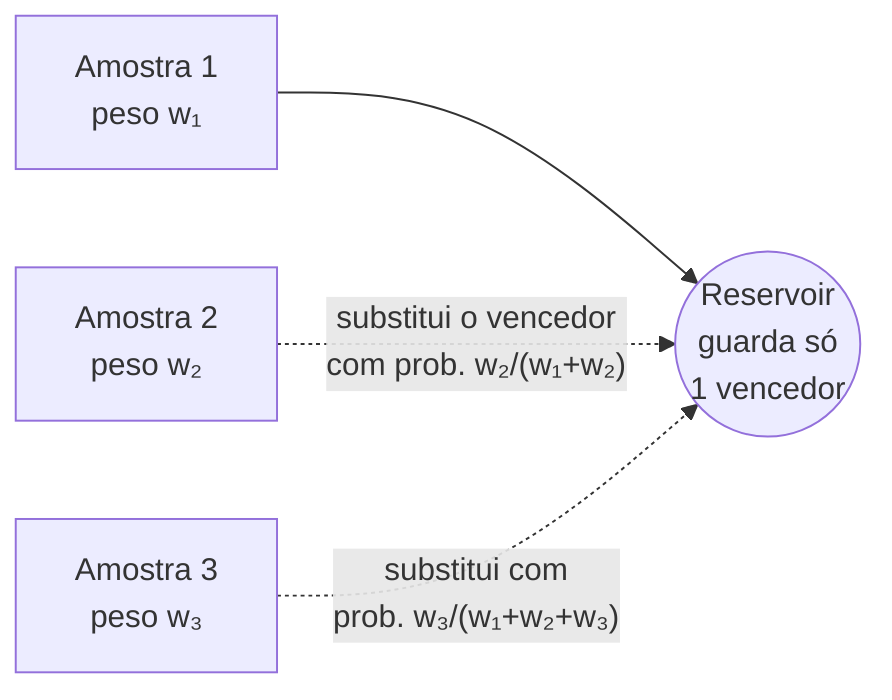
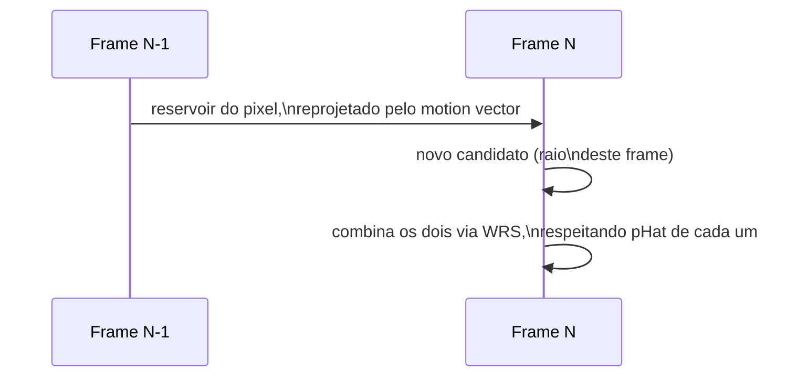
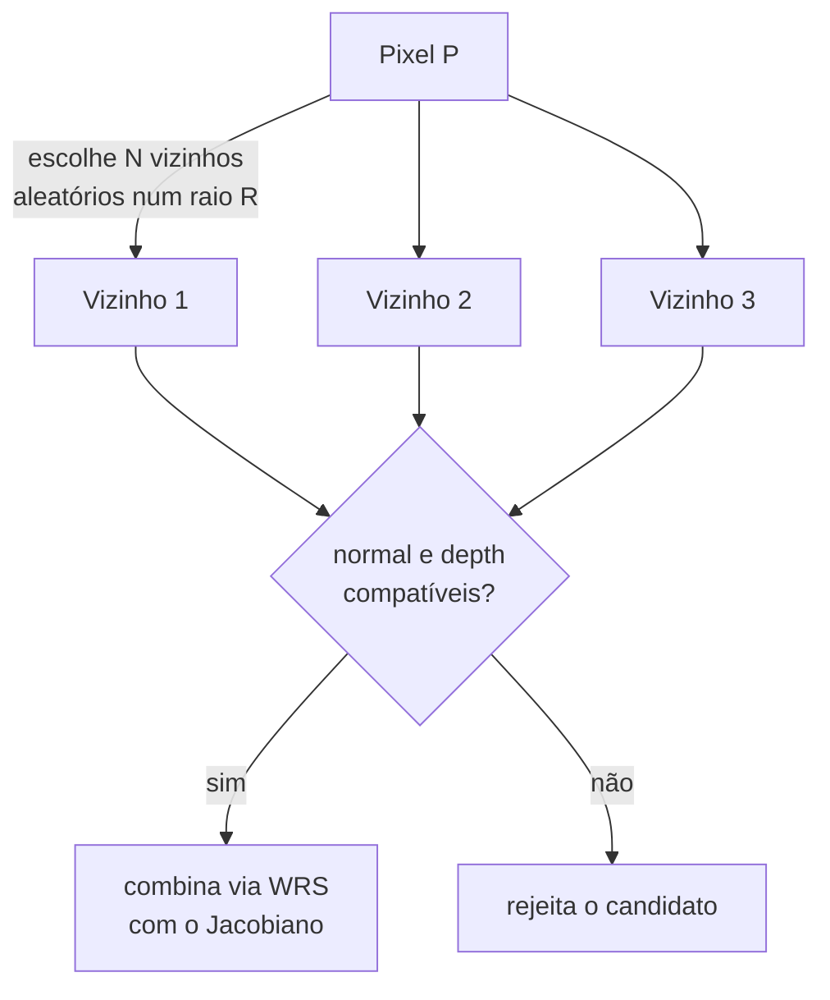
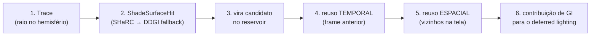
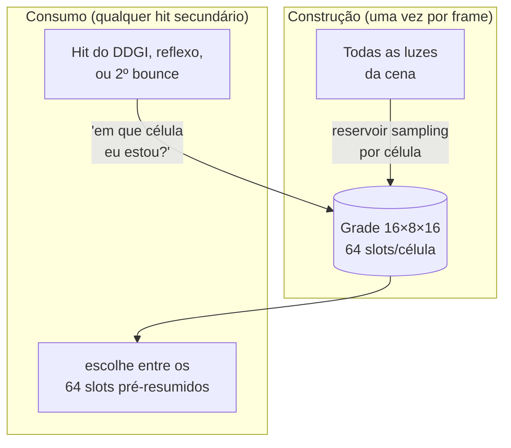

# Capítulo 5 — ReSTIR, DI, GI e ReGIR

> [Índice](00-Indice.md) · Anterior: [Capítulo 4 — SHaRC](04-SHaRC-Radiance-Cache.md) ·
> Próximo: [Capítulo 6 — Orquestração (IndirectPolicy)](06-Orquestracao-IndirectPolicy.md)

Os capítulos 3 e 4 explicaram **onde a luz mora** (nas sondas do DDGI, nas células do
SHaRC). Este capítulo explica a peça que efetivamente **decide a cor final de cada pixel**:
o **ReSTIR** — *Reservoir-based Spatio-Temporal Importance Resampling*. É o sistema mais
"matemático" do curso, mas a ideia central é surpreendentemente simples e vale a pena
entender bem, porque ela se repete três vezes na engine (para GI, para luz direta, e para
pré-seleção de luzes locais).

## 5.1 O problema que o ReSTIR resolve

Imagine que você quer estimar "quanta luz chega neste pixel, vinda de qualquer direção".
A forma exata seria somar a contribuição de **todo** raio possível, em **toda** direção
possível — impossível em tempo real (Capítulo 1). A alternativa mais simples é **amostrar**:
disparar só 1 ou 2 raios por pixel e tratar o resultado como uma estimativa. O problema óbvio
é que 1 ou 2 amostras são **extremamente** ruidosas — a imagem parece estática granulada.

A pergunta do ReSTIR é: *"Em vez de jogar fora a amostra do pixel vizinho (que fez um
trabalho parecido) e a do frame anterior (que também mediu algo parecido), por que não
reaproveitá-las estatisticamente — sem introduzir viés (erro sistemático) na imagem final?"*

## 5.2 Reservoir sampling: escolher "o melhor entre muitos" sem guardar todos

A base matemática chama-se **weighted reservoir sampling (WRS)**. A analogia mais simples é
uma rifa em que você não sabe, de antemão, quantos bilhetes vai receber, mas ainda assim
quer que, no fim, cada bilhete tenha tido a chance certa (proporcional ao seu "peso") de ser
o vencedor — sem guardar a lista inteira de bilhetes na memória, só o vencedor atual.



Na Smile, isso é o `struct Reservoir` (`Shaders/GI/ReSTIRReservoir.hlsli`):

```hlsl
struct Reservoir {
    float3 x1;   // ponto visível (o pixel que está sendo sombreado)
    float3 x2;   // ponto da amostra (onde o raio bateu)
    float3 n2;   // normal no ponto da amostra
    float3 Lo;   // radiância medida em x2, na direção de x1
    float  M;    // quantas amostras "passaram" por este reservoir até agora
    float  W;    // peso final, não-enviesado, de contribuição
    float  wSum; // soma acumulada dos pesos de resampling (uso interno do algoritmo)
};
```

O truque matemático que faz isso **não** ser um viés — e não uma média qualquer — é que cada
amostra candidata só substitui a atual com probabilidade proporcional ao seu próprio peso
(`wSum` cresce e a chance de troca é `peso_novo / wSum`), e o **peso final `W`** é calculado
de um jeito que compensa exatamente a forma como as amostras foram descartadas ao longo do
caminho. É o mesmo princípio de **importance sampling** de qualquer path tracer, só que
aplicado sobre um fluxo de candidatos que chega ao longo do tempo e do espaço da tela, em
vez de todos de uma vez.

## 5.3 A função-alvo (`pHat`): o que decide se uma amostra é "boa"

Para saber se vale a pena "trocar" o vencedor atual por um candidato novo, o algoritmo
precisa de uma função simples que dê uma nota à amostra — quanto maior a nota, maior a
chance de vencer:

```hlsl
// TargetPHat: luminância × cosseno do ângulo entre a normal e a direção da amostra
float TargetPHat(float3 x1, float3 n1, float3 x2, float3 Lo) {
    float3 d = x2 - x1;
    float  cosT = saturate(dot(n1, normalize(d)));
    return ReSTIR_Luminance(Lo) * cosT;
}
```

Em português: **uma amostra vale mais se ela é brilhante (`Lo` alto) e se ela chega de uma
direção próxima da normal da superfície** (luz rasante contribui menos — é a mesma lei do
cosseno de Lambert que qualquer modelo de iluminação difusa usa).

## 5.4 Reuso temporal: aproveitar o frame anterior

O primeiro tipo de reuso é ao longo do **tempo**: o reservoir do pixel no frame anterior é
"trazido para o presente" e tratado como mais um candidato — desde que ele ainda descreva
**o mesmo ponto do mundo** (não um ponto qualquer que, por coincidência, projeta no mesmo
pixel depois que a câmera se moveu).



Um detalhe de engenharia interessante: o **ponto visível (`x1`) não é mais armazenado** no
reservoir gravado em textura — ele é **reconstruído** a partir do histórico de superfície
(`FTemporalMotionVectors`, que já guarda a posição do frame anterior por outros motivos) ou,
no caso espacial, a partir do *depth* do pixel vizinho, que o passe já carrega mesmo assim
para o teste de rejeição. Isso economiza 16 bytes por pixel — o formato final do reservoir
cabe em **32 bytes**, divididos em duas texturas (`Res0` em ponto flutuante, `Res1` em
inteiros compactados: normais em octaédrico+snorm, radiância em RGB9E5 — o mesmo formato de
`R9G9B9E5_SHAREDEXP` do DirectX, mas escrito manualmente porque o canal é um `uint`
genérico).

`M` tem um **teto** (`MCap`, padrão 20): sem ele, um reservoir muito antigo dominaria
estatisticamente qualquer amostra nova, e a imagem demoraria demais para reagir a mudanças
(uma luz que se apaga, por exemplo). Limitar `M` é o equivalente, em espírito, à histerese
do DDGI (Capítulo 3) — trocar precisão por capacidade de resposta.

## 5.5 Reuso espacial: aproveitar os vizinhos na tela

O segundo tipo de reuso é entre **pixels vizinhos**, no mesmo frame: depois do reuso
temporal, cada pixel também olha para alguns vizinhos aleatórios dentro de um raio
(`SpatialRadius`, padrão 16 pixels; `SpatialCount`, padrão 4 vizinhos) e tenta reaproveitar
os reservoirs deles.



Reuso espacial não é gratuito: dois pixels vizinhos têm posições **ligeiramente diferentes**
(`x1` diferente), então a amostra do vizinho (calculada para o `x1` dele) precisa ser
**reponderada** para valer para o `x1` do pixel atual — essa correção matemática se chama
**Jacobiano de reconexão** (por isso o reservoir guarda `n2`, a normal no ponto de impacto:
ela entra direto nessa correção). Um teste de rejeição (`NormalReject`, padrão 0,9 — o
cosseno mínimo entre as normais) evita combinar amostras de superfícies claramente diferentes
(por exemplo, um vizinho do outro lado de uma quina).

### O filtro de fervura (*boiling filter*)

Ocasionalmente, um único raio "de sorte" encontra uma fonte de luz muito brilhante e gera um
peso desproporcional — que, se espalhado pelo reuso espacial, criaria um pixel (ou uma
mancha de pixels) branco-estourado, piscando: o efeito é apelidado de **fervura** (*boiling*)
na literatura. `BoilingStrength` (desligado por padrão) amortece esse tipo de pico
estatístico antes que ele se propague.

## 5.6 ReSTIR GI: o "final gather" por pixel

`FReSTIRGI` (`Engine/Include/Smile/Graphics/GI/ReSTIRGI.h`) é a aplicação de tudo isso à luz
**indireta**. O fluxo, por pixel, é:

1. **Trace**: dispara um raio a partir da superfície visível, na direção de uma amostra do
   hemisfério (ponderada pela BRDF do material).
2. O raio bate em algo — esse hit passa pelo `ShadeSurfaceHit` do Capítulo 2, que consulta
   SHaRC/DDGI (Capítulos 3 e 4) para saber a radiância que "volta" daquele ponto.
3. Esse resultado vira um **candidato** no reservoir do pixel.
4. **Reuso temporal** (Seção 5.4) com o reservoir do frame anterior.
5. **Reuso espacial** (Seção 5.5) com vizinhos na tela.
6. O `W` final do reservoir combinado, multiplicado pela BRDF, é a contribuição de GI que
   entra no *deferred lighting* (`Docs/ARCHITECTURE.md` §5.2, passo 14).



Duas opções valem menção porque mudam o comportamento de forma perceptível:

- **`Visibility`** (desligado por padrão): soma raios de visibilidade extras durante o reuso
  espacial — sem isso, o algoritmo pode combinar amostras que são estatisticamente válidas
  mas geometricamente impossíveis (a luz do vizinho não conseguiria realmente alcançar este
  pixel por causa de um obstáculo).
- **`HalfRes`** (experimental, desligado por padrão): traça só a meio-res. A reconstrução
  para full-res **não** é um upsample simples — é uma reconstrução **temporal em quatro
  fases**: a cada frame, um quadrante diferente de um bloco 2×2 recebe uma amostra nova
  traçada de verdade, e os outros três reaproveitam o histórico (rejeitado por
  profundidade/normal, com um filtro bilateral como reserva para pixels sem histórico
  válido) — ao longo de 4 frames, todo pixel acaba recebendo uma amostra própria. Uma troca
  clássica de resolução espacial por velocidade, com o custo temporal amortizado em vez de
  pago de uma vez; ainda em avaliação na engine, por isso o default continua desligado.

## 5.7 ReSTIR DI: o mesmo princípio, para luz direta de muitas fontes

`FReSTIRDI` (`Engine/Include/Smile/Graphics/Lighting/ReSTIRDI.h`) resolve um problema
diferente, mas com a mesma ferramenta matemática: **quando existem centenas de luzes locais**
(postes, janelas, tochas), testar visibilidade contra **todas** elas, em todo pixel, seria
proibitivo. Em vez disso, o ReSTIR DI:

1. Escolhe candidatas entre as luzes (amostragem ponderada por brilho/distância);
2. Usa reservoir sampling — exatamente como na Seção 5.2, mas a "amostra" aqui é **qual
   luz** e não **qual direção de quique**;
3. Testa visibilidade real (shadow ray) só para a luz **vencedora** do reservoir, não para
   todas as candidatas;
4. Aplica o mesmo reuso temporal + espacial das seções 5.4–5.5.

O resultado prático: qualidade equivalente a testar dezenas de luzes por pixel, pagando o
custo de shadow ray de **uma só**.

## 5.8 ReGIR: pré-selecionar luzes numa grade de mundo

`FReGIR` (`Engine/Include/Smile/Graphics/GI/ReGIR.h`, referência: *Ray Tracing Gems II*,
capítulo 23) resolve um problema adjacente: os **hits secundários** (o segundo quique de uma
sonda DDGI, o hit de um raio de reflexo, etc.) também precisam escolher "qual luz local
considerar" — mas eles não têm o luxo de reuso temporal/espacial por pixel de tela como o
ReSTIR DI (esses hits acontecem em posições 3D arbitrárias, não numa grade de pixels
estável).

A solução é pré-computar, **uma vez por frame**, uma grade 3D fixa de células
(`kGridX×kGridY×kGridZ = 16×8×16`), cada uma guardando `kSlotsPerCell = 64` reservoirs — ou
seja, cada célula do mundo já chega com "as luzes mais relevantes por aqui" pré-resumidas via
reservoir sampling, antes mesmo de qualquer hit específico acontecer:



Vale notar a divisão de trabalho: **a superfície primária continua com o ReSTIR DI**
(Seção 5.7) — o ReGIR existe especificamente para os hits secundários, compartilhados entre
DDGI, reflexões e ReSTIR GI, onde não há pixel de tela estável para ancorar reuso
temporal/espacial tradicional.

## 5.9 Por que "quase-mágica estatística" não é exagero

Vale reforçar, porque é fácil duvidar à primeira vista: reservoir sampling com reuso
temporal e espacial **não** é uma média com desfoque disfarçada, nem um truque que
"esconde" o ruído borrando a imagem. É uma técnica de **importance sampling não-enviesada**
— o peso `W` de cada reservoir combinado é calculado para que, em expectativa (ao longo de
muitos frames/pixels), o resultado convirja para a **mesma resposta correta** que path
tracing "de força bruta" daria, só que chegando lá com muito menos raios por pixel. É por
isso que o ReSTIR (publicado originalmente em 2020, Bitterli et al., e estendido para GI por
Ouyang et al. 2021 — o paper citado direto no código da Smile) foi um divisor de águas na
indústria: ele é a peça que torna viável usar caches relativamente grosseiros (DDGI, SHaRC)
como fonte, e ainda assim produzir uma imagem que parece ter sido calculada com muito mais
raios do que realmente foram.

## 5.10 Resumo do capítulo

| Conceito | O que resolve |
|---|---|
| Reservoir (WRS) | Escolhe "o melhor candidato até agora" sem guardar todos, sem viés |
| `pHat` (luminância × cosseno) | Dá nota a cada candidato, guia quem vence a rifa |
| Reuso temporal (`M`, teto `MCap`) | Aproveita o frame anterior sem deixá-lo dominar para sempre |
| Reuso espacial + Jacobiano | Aproveita vizinhos na tela, corrigindo a mudança de ponto de vista |
| Filtro de fervura | Evita que um raio de sorte vire um pixel branco piscando |
| ReSTIR GI | Final gather difuso por pixel, terminador = SHaRC/DDGI (Cap. 2–4) |
| ReSTIR DI | Escolhe qual luz local testar visibilidade, entre centenas |
| ReGIR | Pré-resume luzes numa grade de mundo, para hits secundários sem pixel estável |

Siga para o [Capítulo 6 — Orquestração (IndirectPolicy)](06-Orquestracao-IndirectPolicy.md),
onde os três sistemas dos capítulos 3–5 se juntam na peça de código que decide, a cada
frame, quem realmente manda.
