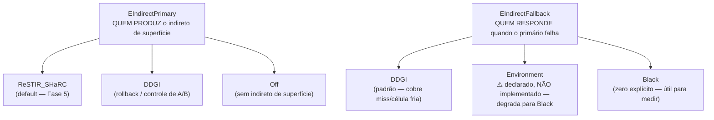
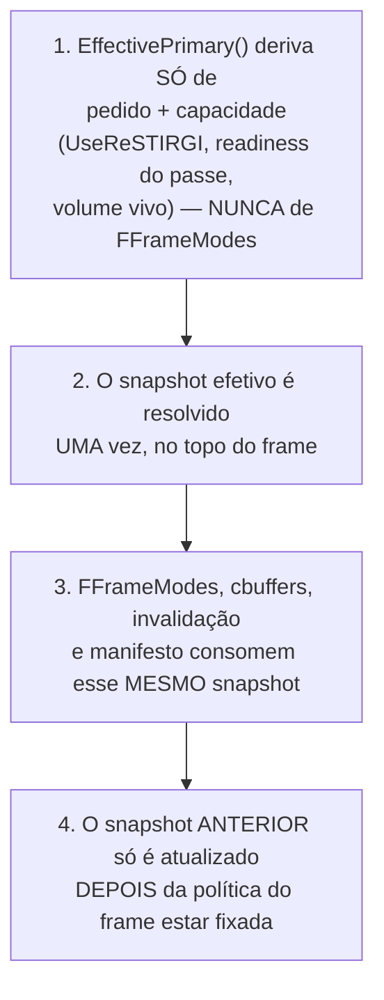
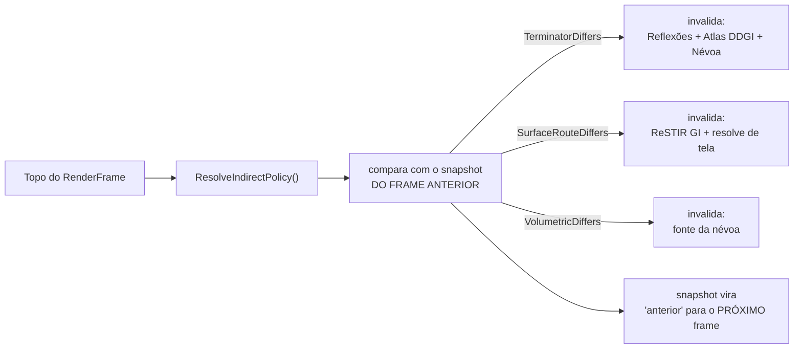
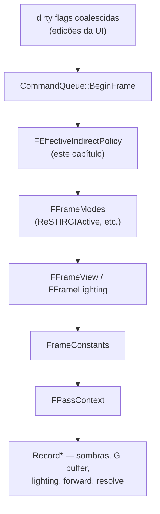

# Capítulo 6 — Orquestração: quem manda em cada frame

> [Índice](00-Indice.md) · Anterior: [Capítulo 5 — ReSTIR](05-ReSTIR-DI-GI-ReGIR.md) ·
> Próximo: [Capítulo 7 — Denoising, Histórico e Debug](07-Denoising-Temporal-Debug.md)

Os capítulos 3, 4 e 5 explicaram três sistemas capazes de produzir (ou consultar) luz
indireta. Este capítulo explica a peça de código que decide, **a cada frame**, qual deles
está de fato no comando: `Engine/Include/Smile/Graphics/GI/IndirectPolicy.h`. Vale a pena um
capítulo inteiro para isso porque essa decisão já causou bugs reais e sutis na história do
projeto — e o jeito como ela foi corrigida ensina uma lição de arquitetura que vale além da
GI.

## 6.1 O bug que motivou este header existir

Até certo ponto do desenvolvimento, existia um único booleano, `UseGI`, e ele era testado em
**oito lugares diferentes** do `Renderer.cpp` — mas, ao serem auditados, esses oito lugares
na verdade respondiam **três perguntas distintas**:

1. *"O passe do DDGI deve rodar neste frame?"* (uma questão de **orçamento** — traçar sondas
   custa tempo de GPU, independente de quem usa o resultado depois)
2. *"O DDGI deve responder quando um raio secundário erra o cache?"* (uma questão de
   **política de fallback**)
3. *"O deferred e a névoa devem ler o atlas do DDGI?"* (uma questão de **consumo**)

Um único nome (`UseGI`) escondendo três perguntas diferentes teve uma consequência concreta:
em certo momento, um gate de validação foi escrito assumindo que `UseGI` controlava se o
ReSTIR GI executava — não controlava (`ReSTIRGIActive` sempre dependeu de outro campo,
`UseReSTIRGI`) — e o resultado foi **um botão na interface do editor que não fazia nada**,
por um tempo, sem que ninguém percebesse imediatamente. O nome mentia, e alguém confiou no
nome.

Esse episódio é o motivo declarado, no próprio comentário do header, para a taxonomia que
este capítulo explica.

## 6.2 As duas perguntas que a política responde



- **`EIndirectPrimary`**: quem produz o indireto de superfície que a **tela** mostra. Não é
  uma escala de qualidade — são **estimadores diferentes, com históricos diferentes**, e
  trocar entre eles precisa invalidar acumuladores (Capítulo 7).
- **`EIndirectFallback`**: quem responde quando o primário não consegue — um miss do
  cache, uma célula ainda fria (aquecendo), ou geometria que o SHaRC não pode representar
  (segmento curto, cone estreito — Capítulo 4, Seção 4.6).

A escolha do fallback **não é cosmética**. A Fase 5 do plano de implementação mediu o
tamanho exato dela: o DDGI responde **30,14%** dos hits secundários na cena de referência.
Trocar o fallback de DDGI para preto não escurece 30% do brilho de forma uniforme — apaga
**30% dos caminhos de luz**, e o resultado é uma imagem mais escura de forma desigual
(mais escura exatamente onde o cache SHaRC ainda não tinha resposta).

> ⚠️ **Environment está declarado, mas não implementado.** O enum tem essa opção
> nomeada — "responder com a cor de ambiente" — mas não existe cor de ambiente disponível
> no cbuffer de um passe de ray tracing hoje, e o gather já desvanece para preto fora do
> volume por esse motivo. Pedir `Environment` **degrada silenciosamente para `Black`**. Isso
> é uma decisão deliberada de honestidade: o enum guarda a intenção nomeada, em vez de
> esconder a pendência atrás de um valor que ninguém de fato implementa.

## 6.3 O terceiro papel do DDGI (voltando ao que o Capítulo 3 adiantou)

Mesmo com `Primary = ReSTIR_SHaRC`, o DDGI **continua** iluminando três consumos que
nenhum outro sistema cobre: folhagem, o termo traseiro de *subsurface scattering*, e os
translúcidos do `ForwardBlend`. Por isso a regra de disponibilidade **não pode** ser
simplificada para "`DDGISurfaceAvailable() == (EffectivePrimary() == DDGI)`" — se fosse,
escolher SHaRC como primário apagaria as três coisas de uma vez, em silêncio, como efeito
colateral de uma troca que prometia só mudar o terminador dos raios.

A regra correta, registrada no código:

```
DDGISurfaceAvailable() = DDGIVolumeLive() && EffectivePrimary() != Off
```

Ou seja: **o atlas ilumina superfície enquanto existir algum indireto de superfície — seja
ele qual for.** Só some quando o primário inteiro é desligado (`Off`).

### Os estados alcançáveis (e um que não é)

| Configuração | O que acontece |
|---|---|
| `ReSTIR_SHaRC` + fallback `Black` + volume vivo | SHaRC nos raios, sem DDGI como terminador. **Auxiliares continuam** (folhagem, subsurface, translúcidos) e a névoa também. |
| `ReSTIR_SHaRC` + volume desligado | SHaRC sem nenhum DDGI em superfície — mas a **volumetria perde o atlas junto**, então a névoa muda também. Não é uma medida isolada "só de superfície". |
| `Primary = Off` | Nenhum indireto de superfície — e isso **apaga o SHaRC também**, não isola o DDGI. |
| ~~SHaRC sem DDGI em superfície, mantendo DDGI na névoa~~ | **Não é alcançável hoje.** Exigiria um toggle explícito para o papel de "auxiliar de superfície" que ainda não existe. |

## 6.4 Quatro perguntas nomeadas — nunca reconstruídas por fora

Cada um dos dez pontos do `Renderer.cpp` que dependiam do antigo `UseGI` foi reclassificado
para terminar numa destas quatro perguntas, cada uma com seu próprio método:

| Método | Responde | Categoria |
|---|---|---|
| `DDGIVolumeLive()` | O passe do DDGI executa/mantém o volume neste frame? | Orçamento |
| `EffectiveFallback() == DDGI` | Os raios usam DDGI como fallback? | Política |
| `DDGISurfaceAvailable()` | Deferred, folhagem, subsurface, translúcidos, debug de GI podem ler o atlas? | Consumo |
| `DDGIVolumetricAvailable()` | A névoa lê o atlas? | Consumo (só volumétrico) |
| `EffectivePrimary()` | Quem é o estimador principal de superfície na tela? | Roteamento |

Um critério de revisão registrado no próprio header resume a regra: **se um `UseGI`
sobreviver em algum lugar do código, ou se alguém escrever `DDGIVolumeLive()` num ponto
puramente volumétrico, a classificação falhou — mesmo que a imagem renderizada continue
idêntica.** É um critério estrutural, não visual: o objetivo é impedir que a mesma confusão
history se repita, não só corrigir o sintoma de hoje.

## 6.5 A ordem de resolução: o que impede um ciclo

Existe uma armadilha lógica possível aqui: se `EffectivePrimary()` perguntasse ao **modo do
frame** (`FFrameModes`) para decidir o que ele mesmo deveria produzir, isso seria um ciclo —
a política dependeria do que ela mesma define. A ordem de resolução, um invariante
registrado no código, evita isso:



A degradação em si segue uma cadeia simples: **`ReSTIR_SHaRC` pedido → `ReSTIR_SHaRC` se o
passe estiver pronto → senão `DDGI` se o volume estiver vivo → senão `Off`.** Note que a
segunda comparação, em código, testa `!= Off` e não `== DDGI` — de propósito, porque isso
cobre ao mesmo tempo dois casos diferentes: o rollback pedido manualmente pelo operador **e**
a queda automática por indisponibilidade (por exemplo, o passe do SHaRC ainda não estar
pronto neste frame específico). `Off` só é alcançado se **pedido** — degradar
automaticamente para `Off` por indisponibilidade apagaria a imagem inteira em silêncio, o
que seria pior que cair para o DDGI.

## 6.6 O detector de borda: por que um setter não basta

Aqui está o ponto mais sutil do capítulo, e a razão pela qual esta política não é "só um
enum com um getter/setter". **O valor efetivo pode mudar sem que ninguém tenha chamado
nenhum setter** — basta o volume do DDGI aparecer ou desaparecer (uma troca de cena, um
resize que recria o volume), ou o passe do SHaRC deixar de estar pronto por um frame. Se a
invalidação de histórico só acontecesse dentro dos setters, esses casos passariam batido —
e o terminador do raio secundário trocaria **sem que ReSTIR GI, o atlas do DDGI ou o NRD
(Capítulo 7) esquecessem o que acumularam sob a política anterior**.

A solução é um **detector de borda por domínio**, avaliado uma vez por frame, no topo —
antes de qualquer consumidor publicar seu constant buffer:



Repare que são **três perguntas separadas**, cada uma mapeada para um domínio de invalidação
diferente (`HistoryDomain.h`) — não uma pergunta genérica de "algo mudou?". Isso importa
porque cada tipo de mudança tem um raio de efeito diferente:

| Pergunta | O que muda | Por quê é separada |
|---|---|---|
| `TerminatorDiffers` | O que os raios secundários encontram no *miss* — inclui o **atlas do DDGI**, porque o segundo quique das sondas termina no mesmo `ShadeSurfaceHit` | É a única que arrasta a névoa junto (ver 6.7) |
| `SurfaceRouteDiffers` | Quem produz o indireto **na tela** | Não move raio nenhum — o atlas continua de pé, a névoa nem é notificada |
| `VolumetricDiffers` | A fonte da névoa (o volume apareceu/sumiu de verdade) | Independente das outras duas |

### O primeiro valor observado não é uma borda

Um detalhe fácil de errar: a **primeira vez** que a política é lida (o frame em que a cena
carrega) não pode ser tratada como "mudança" — `uninitialized → DDGI` não é uma borda, é só
o começo da observação. Se fosse tratado como borda, **toda cena nova invalidaria histórico
no primeiro frame** (inofensivo, já que não há histórico ainda) e, pior, **cancelaria
qualquer sessão de captura determinística recém-aberta** (Capítulo 7), porque a invalidação
passa pelo mesmo funil que a captura observa.

## 6.7 A correção que a revisão pegou: "a névoa não muda" era falso

A primeira versão desta classificação errou de um jeito instrutivo, e o próprio código
documenta o erro para ninguém repeti-lo. A ideia original era: *"a névoa lê o atlas do DDGI
diretamente e continua lendo exatamente o mesmo — ela não precisa ser invalidada quando o
primário de superfície muda."*

Essa frase está errada porque trata o atlas como um **recurso estático que se lê**, quando
na verdade ele é também um **acumulador temporal** (Capítulo 3, Seção 3.4) e um consumidor
da própria política: se a troca do **fallback** reseta o atlas (porque muda o que o segundo
quique das sondas encontra), a névoa passaria a reprojetar *inscatter* somado sobre um atlas
que acabou de ser resetado — misturando um histórico de "antes" com um atlas de "depois do
reset", uma inconsistência visível.

A regra final, mais curta que o parágrafo que ela substitui: **quem reseta o atlas leva a
névoa junto.** É por isso que `TerminatorDiffers` inclui a névoa no seu domínio de
invalidação, e as outras duas perguntas não incluem.

## 6.8 O manifesto grava pedido *e* efetivo — nunca só um

Toda captura determinística (Capítulo 7) grava **dois** valores para primário e fallback:
o que foi **pedido** e o que foi **efetivo**. Gravar só o efetivo pareceria suficiente (afinal,
é o que a imagem mostra) — mas apagaria a informação de **degradação**: um manifesto que diz
apenas `"fallback": "black"` não distingue três situações completamente diferentes:

1. o operador **pediu** preto, de propósito, para medir a contribuição do DDGI;
2. o operador pediu DDGI, mas **não havia volume** disponível naquele frame;
3. o operador pediu `Environment`, que **não existe** e foi degradado.

Três configurações diferentes, o mesmo pixel na imagem — e a lição registrada é que "duas
capturas indistinguíveis na pasta são um convite a compará-las incorretamente" mais tarde.

## 6.9 A matriz de testes de runtime (o gate de saída da Fase 6)

O plano de implementação (`Docs/SHARC-PRIMARY-GI-PLAN.md`) define seis configurações fixas
que precisam passar antes de a política ser considerada "fechada". Reproduzi-la aqui ajuda a
entender, na prática, como cada combinação se comporta:

| # | Primário | Fallback | O que tem que acontecer |
|---|---|---|---|
| 1 | `ReSTIR + SHaRC` | `DDGI` | Equivalente visual ao estado anterior ao seletor existir — é o **controle** |
| 2 | `ReSTIR + SHaRC` | `Black` | Mostra a contribuição residual do DDGI; **fog e auxiliares continuam** |
| 3 | `DDGI` | `DDGI` | ReSTIR GI **para de executar**; NRD indireto cai, reflexões saem sem denoiser |
| 4 | `Off` | — | Indireto de superfície some; direta e névoa (DDGI) continuam |
| 5 | `DDGI`, volume desligado | — | Degradação: efetivo cai para `off` |
| 6 | troca de política **durante** uma captura | — | Captura cancela, históricos reiniciam corretamente, zero erro de validação |

O teste #3 merece destaque porque expõe um acoplamento fácil de esquecer: escolher `DDGI`
como primário **também tira o denoiser NRD das reflexões** (porque `NrdIndirectMode`
depende de `ReSTIRGIActive`, que cai junto com o ReSTIR GI). Comparar o resultado do teste 3
com a baseline **sem** notar essa mudança no reflexo é, nas palavras da própria
documentação, "o erro fácil aqui".

## 6.10 Onde isso se encaixa no frame inteiro

Para fechar o quadro: a política resolvida no topo do frame alimenta `FFrameModes`, que por
sua vez decide quais passes executam — o diagrama completo do frame está em
`Docs/RENDERER.md`, seção "Anatomia de RenderFrame". A relação, resumida:



`FFrameModes` **deriva** da política — ele nunca deve voltar a consultar toggles brutos para
recompor uma decisão que já foi tomada. Esse é, de novo, o mesmo princípio da Seção 6.5: a
decisão acontece **uma vez**, no topo, e todo o resto do frame **consome** essa decisão em
vez de recalculá-la em paralelo.

## 6.11 Resumo do capítulo

| Conceito | O que resolve |
|---|---|
| `EIndirectPrimary` / `EIndirectFallback` | Separa "quem produz" de "quem cobre a falha" — dois eixos, não um |
| Quatro perguntas nomeadas | Substitui um booleano ambíguo por métodos que dizem exatamente o que respondem |
| Ordem de resolução (1 vez, no topo) | Impede ciclo entre a política e o que ela mesma define |
| Detector de borda por domínio (3 perguntas) | Invalida só o que realmente mudou, não tudo a cada frame |
| "Quem reseta o atlas leva a névoa junto" | Corrige um caso em que "não muda" na verdade mudava |
| Manifesto grava pedido + efetivo | Preserva a informação de degradação, essencial para comparar capturas |

Siga para o [Capítulo 7 — Denoising, Histórico e Debug](07-Denoising-Temporal-Debug.md), que
fecha o ciclo explicando como a engine limpa o ruído residual, como ela sabe *quando* jogar
fora o que acumulou, e quais ferramentas visuais existem para diagnosticar tudo isso.
