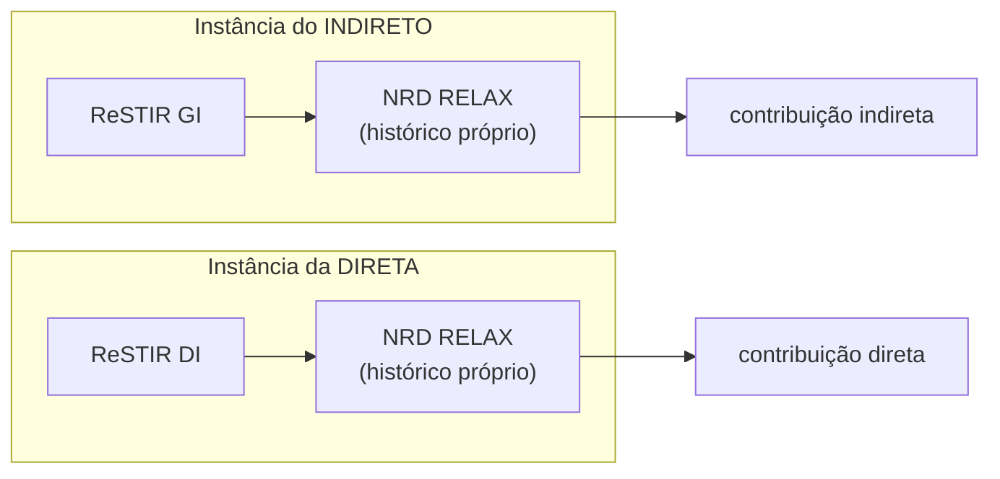

# Capítulo 7 — Denoising, Histórico e Debug

> [Índice](00-Indice.md) · Anterior: [Capítulo 6 — Orquestração](06-Orquestracao-IndirectPolicy.md) ·
> Próximo: [Capítulo 8 — Glossário e Referências](08-Glossario-Referencias.md)

Os capítulos 3 a 6 mostraram **como a luz é produzida**. Este capítulo fecha o ciclo com duas
perguntas complementares: **como o ruído residual é limpo** (denoising) e **como a engine
sabe quando um valor acumulado deixou de ser válido e precisa ser jogado fora** (invalidação
de histórico) — que a própria documentação da Smile chama, sem exagero, de "o contrato mais
fácil de quebrar" do motor inteiro.

## 7.1 Por que ainda existe ruído depois de tudo isso

Mesmo com DDGI, SHaRC e ReSTIR trabalhando juntos, a imagem "crua" — antes de qualquer
filtro adicional — ainda carrega ruído perceptível, principalmente no indireto. Isso não é
falha de nenhum dos três sistemas: é a natureza de qualquer técnica baseada em amostragem
estocástica (Capítulo 1). A resposta da engine para o ruído residual é um **denoiser
temporal-espacial dedicado**, separado da lógica de reamostragem do ReSTIR.

## 7.2 NRD: duas instâncias independentes, de propósito

A Smile integra o **NRD** (*NVIDIA Real-time Denoisers*, especificamente o algoritmo
**RELAX**, otimizado para sinais de path tracing com poucas amostras) — mas não como uma
instância única compartilhada. `FNrdDenoiser` roda **duas vezes**, uma para a luz indireta
e outra, totalmente separada, para a direta:



Por que duas, e não uma compartilhada? Porque luz direta e indireta têm **características de
sinal muito diferentes** — a direta tende a ter bordas de sombra nítidas e mudar rápido
(uma luz que liga/desliga), a indireta é mais suave mas mais ruidosa. Se as duas
compartilhassem um único histórico temporal, uma mudança brusca na direta **contaminaria**
a reconstrução da indireta (e vice-versa) — os dois sinais "vazariam" um no outro através do
filtro. Manter instâncias independentes é o que garante que cada um reprojeta e acumula
segundo a própria física.

## 7.3 O contrato mais fácil de quebrar: invalidação de histórico

Praticamente todo subsistema da engine **acumula informação entre frames**: os atlas do
DDGI, os reservoirs do ReSTIR (DI e GI), a tabela de hash do SHaRC, o histórico dos
denoisers NRD, o TAA, a névoa volumétrica, as nuvens... A regra geral, citada quase
literalmente de `Docs/ARCHITECTURE.md` §5.4, é:

> *Um parâmetro que entra no sinal **gravado** (e não só no que é exibido na tela) precisa
> derrubar tudo que acumulou sobre ele — senão um teste A/B compara um estado misturado, e
> um knob simplesmente parece não fazer nada.*

O motivo de isso ser "fácil de quebrar" é sutil: **o código continua compilando e rodando
perfeitamente** mesmo que alguém esqueça de invalidar um acumulador. O sintoma não é um
crash — é um **bug visual silencioso**, que só aparece quando alguém compara duas
configurações lado a lado e não entende por que a diferença é menor (ou inexistente) do que
deveria ser.

### `HistoryDomain.h`: o grafo de invalidação como dado, não como código espalhado

A engine já teve **19 listas escritas à mão**, uma por tipo de mudança, cada uma listando
"quem cai junto" — parcialmente sobrepostas, fáceis de esquecer de atualizar. A solução foi
representar o grafo inteiro como **dados**: um bit por acumulador (`EHistoryTarget`) e
conjuntos nomeados pelo **motivo** da mudança (`HistoryDomain::*`), não pelos alvos:

```cpp
enum class EHistoryTarget : u32 {
    DDGIAtlas = 1<<0, ReGIR = 1<<1, ReSTIRGI = 1<<2, ReSTIRDI = 1<<3,
    Reflections = 1<<4, NrdIndirect = 1<<5, NrdDirect = 1<<6, /* ...17 no total */
};
```

Cada domínio combina os bits relevantes:

```cpp
// Mudou o que o RAIO ENXERGA no hit (máscara, backface, alpha-test...)
inline constexpr T RayVisibility = T::DDGIAtlas | T::ReSTIRGI | T::Reflections |
                                   T::VolumetricFog | T::ProbeDiagnostic |
                                   T::RadianceCache | Resolve;
```

O ganho prático: quando um sistema **novo** de acumulação nasce (outro denoiser, outro
cache), ele vira **um bit novo**, adicionado aos domínios certos — em vez de alguém precisar
lembrar de acrescentá-lo em sete listas espalhadas pelo código. E quando um knob **muda de
natureza** (deixa de ser "só afeta o que se vê" e passa a afetar "o que é gravado"), a
revisão vira uma pergunta simples: *"este knob pertence a este domínio?"* — em vez de
"esta lista de sete chamadas está completa?".

### Domínios de conteúdo × filtros de tela: uma distinção que virou `static_assert`

Existe uma categoria de acumulador — os **filtros de tela** (TAA, o histórico neural do
DLSS Ray Reconstruction) — que **não pode** ser resetada por uma mudança de conteúdo comum
(mover um slider, criar um objeto). Se fosse, a tela inteira **piscaria** a cada interação
do editor, porque `TAARanLastFrame = false` produz um frame sem antialiasing e
`RRResetPending` produz um frame reconstruído sem histórico neural — ambos visíveis como um
"pop".

A regra correta: filtros de tela só resetam em **corte de câmera** (`CameraCut` — teleporte,
troca de cena) ou quando **o próprio filtro** troca (ligar/desligar TAA, trocar de
denoiser). Mudança de **conteúdo** é absorvida progressivamente pelo próprio filtro (clamp de
vizinhança, teste de desoclusão) — o preço aceito é a mudança aparecer suavemente ao longo
de alguns frames, em vez de instantânea.

O interessante é **como** essa regra é garantida: não é uma convenção documentada em algum
lugar que alguém pode esquecer de seguir — é um **`static_assert`**, verificado em tempo de
compilação:

```cpp
static_assert(!ResetsScreenFilters(RayVisibility), "domínio de conteúdo");
// ...
static_assert(ResetsScreenFilters(CameraCut),
    "CameraCut existe justamente para resetar os filtros de tela");
```

Se alguém, no futuro, adicionar `TemporalAA` a um domínio de conteúdo por engano, **a build
quebra** — o erro deixa de ser um bug visual sutil, encontrado por acaso semanas depois, e
vira uma linha vermelha no compilador, no exato commit que o introduziu.

### Caches de mundo × navegação da câmera: outra distinção com o mesmo tratamento

Simetricamente: `CameraCut` (teleporte, corte de câmera) **não** derruba os caches de
**mundo** — DDGI, ReGIR, SHaRC. O raciocínio: uma sonda de DDGI irradia a mesma coisa
independente de onde a câmera está agora; derrubar o atlas a cada duplo-clique no *outliner*
faria a GI **reconvergir do zero** toda vez — exatamente o oposto do que esses caches
existem para evitar.

Mas isso se **inverte** para a **captura determinística** (`Docs/CAPTURE-PROTOCOL.md`):
quando o objetivo é medir e comparar configurações de forma reproduzível, o estado inicial
precisa ser **conhecido**, não "o que sobrou do trajeto de câmera até aqui" — duas capturas da
mesma pose, alcançadas por caminhos diferentes, dariam números diferentes se os caches de
mundo carregassem histórico do trajeto. Por isso `DeterministicCapture` é definido como o
**universo inteiro** de bits — a diferença exata entre ele e `CameraCut` são justamente os
três bits dos caches de mundo, e essa diferença está codificada, de novo, como
`static_assert`:

```cpp
static_assert(Contains(DeterministicCapture, T::DDGIAtlas | T::ReGIR | T::RadianceCache),
    "os caches de MUNDO são a diferença entre captura e navegação; sem eles a captura "
    "herda o trajeto até a pose e deixa de ser reproduzível");
```

O preço dessa reprodutibilidade é tempo: os caches de mundo levam **centenas de frames** para
reconvergir (histerese 0,99 no DDGI, teto de 64 amostras por célula no SHaRC) — não dezenas.
É por isso que o contador de aquecimento de uma captura conta **frames renderizados de
verdade**, não interações de UI.

## 7.4 Dirty flags coalescidas: por que arrastar um slider não trava o frame

Editar um parâmetro na UI do editor (arrastar um slider de intensidade de luz, por exemplo)
pode disparar o setter correspondente **várias vezes por frame** — um tique por pixel de
movimento do mouse. Se cada chamada de setter invalidasse histórico imediatamente (o que,
internamente, pode exigir um `Flush` da fila de GPU), arrastar um slider **travaria** o
editor.

A solução são versões **coalescidas**: `MarkMaterialRTStateDirty()` e
`MarkIndirectLightingDirty()` apenas **marcam uma flag**; o `RenderFrame` consome essa flag
**uma única vez**, no início do frame, antes de `BeginFrame`. Não importa quantas vezes o
setter foi chamado entre dois frames — a invalidação de fato acontece só uma vez.

> **Regra prática, direto da documentação interna:** ao levar um parâmetro novo para dentro
> de `ShadeSurfaceHit` (ou qualquer coisa que grave em reservoir/atlas), **revise a
> invalidação dele**. Já aconteceu, na história do projeto, de um knob nascer "de sampler
> puro" (só afeta como se olha o resultado) e, em um commit posterior, passar a afetar o
> valor **gravado** — sem que o setter tivesse sido atualizado para acompanhar essa mudança
> de natureza.

## 7.5 As ferramentas de diagnóstico

A engine tem um conjunto de ferramentas voltadas especificamente para inspecionar o estado
de GI — essenciais porque, como visto acima, boa parte dos bugs desse sistema são
**silenciosos** (a imagem final "parece certa" mesmo com um estado interno inconsistente).

| Ferramenta | O que mostra |
|---|---|
| **`DebugTargets`** | Registro global de nome → slot de textura. Qualquer passe publica um alvo (por exemplo, "Radiance cache · ocupação"); o editor lista, filtra por texto e monta uma grade com vários lado a lado |
| **Visualizador do DDGI** | Atlas de irradiância e de distância clicáveis; clicar numa sonda mostra o tile ampliado e os 64 raios individuais (`DDGIDebugRays`) |
| **Visualizador do SHaRC** | Seis modos: `Cells` (estrutura do hash), `HitMiss` (cobertura — verde=usável, laranja=refresh, amarelo=sem amostra), `Lod`, `Converged`, `Age`, `Confidence` (mostra a "frente de aquecimento" avançando) |
| **`GI · fonte do candidato traçado`** | Alvo de debug do ReSTIR GI: colore cada pixel pela fonte que respondeu o *miss* daquele raio — cache, DDGI, ou zero |
| **`FBvhDebugView`** | Raio primário por pixel direto na TLAS — mostra a densidade e o conteúdo real da estrutura de aceleração |
| **`FShaderTimer`** | Heatmap de custo por pixel dentro dos traces de RT (via NVAPI) — onde exatamente o tempo de GPU está sendo gasto |
| **`FFlickerHeatmap`** | Variância temporal por pixel — mede diretamente "quanto este pixel está tremendo entre frames", o sintoma clássico de histórico mal invalidado |
| **`VramTracker`** | Uso de VRAM por categoria (10 categorias, incluindo `GI` e `RaytracingAS`), registrado automaticamente na criação de cada recurso |
| **`FGpuProfiler`** | Timestamps por escopo nomeado (ex.: "DDGI (async)", "Espera do DDGI (async)") — a fonte de todos os números de custo citados nos capítulos anteriores |

## 7.6 Captura determinística: como a engine mede a si mesma de forma confiável

Um detalhe final que amarra os capítulos 3–6: como é possível, na prática, comparar "com o
knob X ligado" contra "com o knob X desligado" de um jeito que realmente isola só aquele
knob? A resposta é o **capturador determinístico** (`Docs/CAPTURE-PROTOCOL.md`,
`FFrameCapture`): ele fixa a pose da câmera, a hora do dia, o índice de amostragem temporal,
espera um número fixo de frames **renderizados** de aquecimento (Seção 7.3), e só então
grava um PNG — junto com um **manifesto** descrevendo o estado *efetivo* completo daquele
frame (não só o que foi pedido — Capítulo 6, Seção 6.8).

É esse protocolo que sustenta praticamente todos os números concretos citados neste curso —
o custo de +0,83 ms da segunda cascata do DDGI (Capítulo 3), a curva de acerto do SHaRC
(Capítulo 4), a diferença de PSNR entre `UpdateMaxVertices = 1` e `= 4`. Sem reprodutibilidade,
nenhum desses números significaria nada — poderiam ser ruído do trajeto até a pose, e não do
knob sendo medido.

## 7.7 Resumo do capítulo

| Conceito | O que resolve |
|---|---|
| NRD, duas instâncias (direta/indireta) | Evita que sinais com física diferente contaminem um ao outro |
| `HistoryDomain.h` (dados, não listas espalhadas) | Um alvo novo = um bit; um domínio errado = erro de compilação |
| Domínios de conteúdo × filtros de tela (`static_assert`) | Impede que um slider comum reset TAA/RR e faça a tela piscar |
| Caches de mundo sobrevivem a corte de câmera | Evita reconvergência do zero a cada navegação no editor |
| `DeterministicCapture` = universo inteiro | A diferença exata (caches de mundo) é o que torna a captura reproduzível |
| Dirty flags coalescidas | Arrastar um slider não trava o frame com invalidações repetidas |
| Visualizadores dedicados (DDGI, SHaRC, fonte do ReSTIR GI) | Torna bugs silenciosos em problemas visíveis e diagnosticáveis |

Siga para o [Capítulo 8 — Glossário e Referências](08-Glossario-Referencias.md), o último
capítulo do curso.
